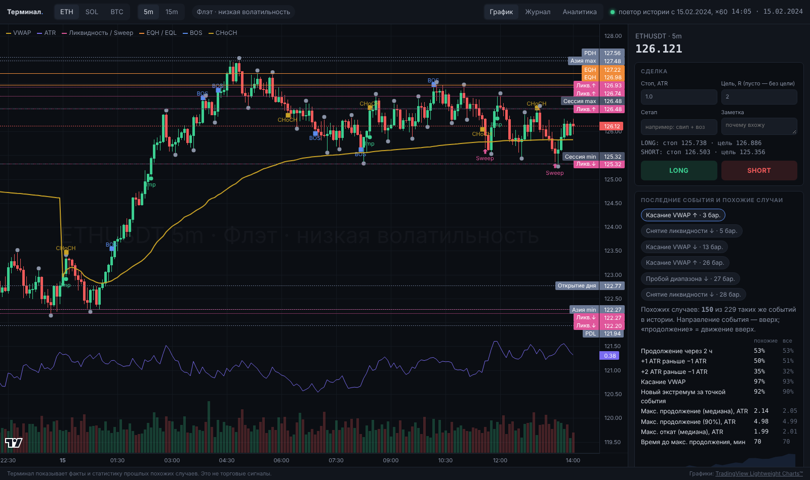
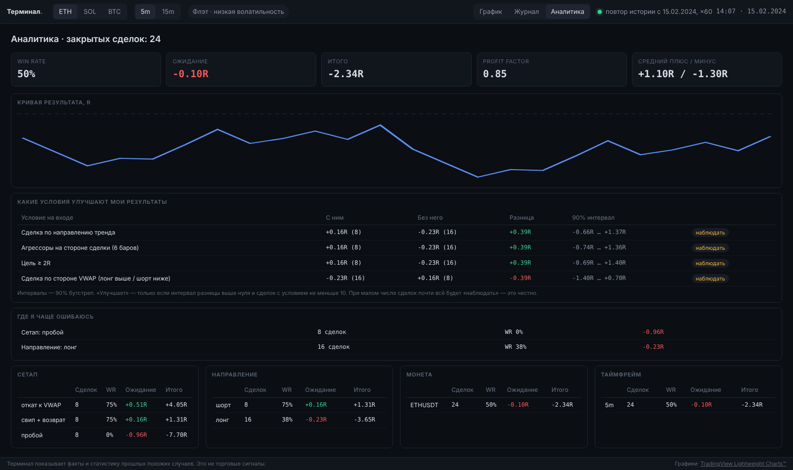

# Торговый терминал

Рабочий инструмент на каждый день. Терминал **не говорит BUY/SELL**. Он показывает объективную картину
рынка и статистику прошлых похожих ситуаций, запоминает каждую вашу сделку и со временем отвечает, что
работает лично у вас.



## Запуск — шаг за шагом

**1. Установите Python 3.11 или новее** — https://www.python.org/downloads/ (на Windows отметьте
«Add Python to PATH»).

**2. Скачайте проект** (архив или `git clone https://github.com/Galtsssov/trading-indicator`) и откройте папку.

**3. Запустите терминал:**
- Windows — двойной щелчок по `start-terminal.bat`;
- macOS — двойной щелчок по `start-terminal.command` (при первом запуске: правый клик → «Открыть»);
- или вручную в терминале:

```bash
python3 -m venv .venv
```

```bash
source .venv/bin/activate
```

```bash
pip install -e ".[terminal]"
```

```bash
qlab-terminal
```

На Windows вместо `source .venv/bin/activate` — `.venv\Scripts\activate`.

Браузер откроется сам на http://127.0.0.1:8777. При первом запуске терминал загружает 30 дней минутных
свечей ETH, SOL и BTC с Binance (1–2 минуты, прогресс — в правом верхнем углу). Следующие запуски
быстрые: история хранится в `data/terminal/live/`.

**4. (Один раз, по желанию) База похожих ситуаций.** Без неё работает всё, кроме блока «похожие случаи».
Скачивает публичный архив Binance с 2020 года (~1–2 ГБ, 15–40 минут):

```bash
python -m qlab fetch
```

```bash
qlab-terminal history
```

Повторять раз в несколько месяцев, чтобы база включала свежие события.

## Как пользоваться каждый день

**Утром.** Откройте терминал, переключайте монеты клавишами `1`, `2`, `3`, таймфрейм — клавишей `t`.
Взгляд на шапку (режим рынка) и правую панель (факты). Панель обновляется сама каждые 3 секунды.

**Когда появляется событие** (снятие ликвидности, пробой, импульсный бар, касание VWAP, выход из
азиатского диапазона) — оно появляется в блоке «Последние события». Терминал сам находит похожие случаи
в истории (того же типа и направления, в похожем контексте: волатильность, VWAP, BTC, время, режим) и
показывает:
- сколько похожих случаев найдено;
- как часто движение продолжилось в сторону события;
- средний путь цены и полосу 25–75 % (график);
- максимальное продолжение и максимальный откат (медиана и 90 %);
- время до максимального продолжения;
- вероятность пройти +1 ATR и +2 ATR раньше отката на 1 ATR, коснуться VWAP, обновить экстремум.

Рядом всегда те же числа для **всех** таких событий — чтобы было видно, отличается ли текущая ситуация
от обычной. Это статистика прошлого, а не сигнал.

**Когда входите в сделку.** Задайте стоп в ATR и цель в R (пусто — без цели), сетап (например,
«свип + возврат») и заметку, нажмите **LONG** или **SHORT**. Терминал сохранит:
- время, цену входа, стоп, цель;
- скриншот графика;
- все факты панели и режим рынка;
- признаки последнего бара (ATR, VWAP, OI, funding, режимы и др.);
- события перед входом;
- условия для аналитики (по тренду ли, по стороне VWAP, были ли агрессоры за вас и т. д.).

Сделка сопровождается автоматически: стоп или цель закрывают её сами (если в одной минуте задеты оба —
засчитывается стоп), MFE и MAE считаются по ходу. Закрыть вручную — кнопка «Закрыть» в панели.
Результат считается в R с учётом комиссий (0.14 % за круг, настраивается в `configs/terminal.toml`).

**Вечером.** Вкладка **Журнал**: скриншот, условия входа, допишите разбор.
Вкладка **Аналитика** — после 20–30 закрытых сделок:
- что работает по сетапам, направлениям, монетам, сессиям, режимам, часам;
- **где вы чаще ошибаетесь** — группы с отрицательным ожиданием;
- **какие условия улучшают результат.** Сравнение «с условием / без него» с 90%-м интервалом. «Улучшает»
  ставится только если интервал выше нуля и сделок с условием не меньше 10. Иначе — «наблюдать»: так
  терминал не выдаёт случайность за закономерность.



## Что на графике

| Элемент | Как определяется |
|---|---|
| Свечи, объём | Binance USDⓈ-M Futures, минутки → 5m/15m. Незакрытый бар виден, но в расчётах не участвует |
| VWAP (жёлтая линия) | Средневзвешенная по объёму цена с 00:00 UTC |
| ATR (фиолетовая, внизу) | ATR(14) Уайлдера |
| Серые точки | Свинг-хай/лоу: экстремум выше/ниже 3 баров слева и справа. Появляется через 3 бара — после подтверждения |
| Sweep (розовые стрелки) | Вынос за экстремум 24 баров ≥ 0.1 ATR и закрытие обратно |
| BOS / CHoCH | Закрытие за последним подтверждённым свингом: BOS — по текущему направлению структуры, CHoCH — против |
| Imp | Импульс: бар с размахом ≥ 2.5 ATR или движение ≥ 2 ATR за 3 бара |
| Ликв.↑ / Ликв.↓ | Ближайшие неснятые свинги — там лежат стопы |
| EQH / EQL | Два неснятых свинга в пределах 0.15 ATR друг от друга |
| PDH/PDL, PWH/PWL | Максимум/минимум вчера и прошлой недели (UTC) |
| Открытие дня, Азия max/min | Открытие суток UTC; диапазон 00–07 UTC |
| Сессия max/min | Диапазон текущей сессии (Азия 00–07, Европа 07–13, США 13–20, поздняя 20–24 UTC) |
| Круглое | Ближайший уровень, кратный 10^(порядок цены − 1) |
| Водяной знак | Монета, ТФ и режим рынка |

## Что в панели фактов

| Блок | Что показывает |
|---|---|
| Режим | Тренд/флэт (эффективность движения за сутки против медианы 90 дней), направление и сила за 96 баров, BTC за сутки, risk on/off |
| Волатильность | ATR в цене и %, процентиль за 30 дней; ожидаемый размах этого часа (медиана за 30 дней) |
| Позиционирование | Funding и время до расчёта; изменение OI за 1 ч и 24 ч; long/short аккаунтов; доля агрессивных покупок |
| Расстояния | До VWAP, ближайшей ликвидности выше/ниже, max/min дня и сессии — в цене и ATR |
| Время | Сессия и время с её начала; время до открытия NYSE (с учётом летнего времени) |

Наведите курсор на строку — появится подсказка с определением.

## Тренажёр: повтор истории
Торговля на прошлых данных с ускорением — без риска, с отдельным журналом (`journal_replay.sqlite`).
Нужен архив (`python -m qlab fetch`).

```bash
qlab-terminal --replay 2024-03-01 --speed 60
```

`--speed 60` — минута рынка за секунду. События и похожие случаи берутся только из прошлого
относительно момента повтора.

## Где хранятся данные
Всё локально в `data/terminal/`. Ключи API не нужны: используются только публичные данные Binance.
- `journal.sqlite` — журнал сделок (делайте резервную копию);
- `screenshots/` — скриншоты сделок;
- `live/` — кэш минутных свечей;
- `history/` — база похожих ситуаций.

Настройки (порт, монеты, частота обновления, комиссии, число похожих случаев) — `configs/terminal.toml`.

## Почему такая технология
Локальное веб-приложение: **FastAPI** (Python) + **TradingView Lightweight Charts** в браузере.
- Бэкенд — уже построенный движок `qlab`. Терминал вызывает его напрямую: сборка баров, признаки
  (ATR, VWAP, режимы, OI, BTC), детекторы событий — тот же код, что прошёл тесты исследования.
  Второго языка и дублирования логики нет.
- Lightweight Charts — быстрый финансовый график (canvas) с привычным трейдерам поведением, работает офлайн:
  библиотека лежит в проекте.
- Никаких Node, Rust и сборщиков: запуск одной командой.
- **Tauri / Electron** дали бы только отдельное окно ценой второго тулчейна и сборки под каждую ОС. Это
  можно добавить позже поверх того же интерфейса, ничего не переписывая.
- **PySide6 / Qt** — заметно беднее и медленнее для финансовых графиков.

## Устройство

```
браузер (static/: app.js, chart.js, panel.js, journal.js, Lightweight Charts)
   │  HTTP, 127.0.0.1
FastAPI (terminal/app.py)
   ├─ sources.py   LiveSource (REST Binance) / ReplaySource (архив)
   ├─ market.py    снимок рынка: qlab.dataset → qlab.features → qlab.events + структура + факты
   ├─ structure.py свинги, ликвидность, EQH/EQL, BOS/CHoCH, импульсы, уровни
   ├─ similar.py   база и поиск похожих ситуаций
   └─ journal.py   SQLite-журнал, сопровождение сделок, личная аналитика
```

Исследовательская платформа (`python -m qlab ...`) не изменена и продолжает работать.

## Ограничения
- Терминал **не отправляет ордера** на биржу: сделки вы открываете в своём торговом приложении,
  а в терминале их записываете.
- Нужен доступ к fapi.binance.com. В некоторых странах Binance Futures недоступен.
- OI и long/short Binance публикует с задержкой около 5 минут.
- Свинги подтверждаются через 3 бара. Это честная задержка, а не перерисовка.
- «Похожие случаи» — статистика прошлого. Режимы рынка меняются, а малое число похожих случаев — повод не доверять цифрам.
- Агрессоры считаются по taker buy volume свечей. Детальный поток сделок (aggTrades) — следующий шаг.

## Если что-то не так
| Симптом | Что делать |
|---|---|
| «нет связи с Binance» | Проверьте интернет; Binance Futures может быть недоступен в вашей стране |
| Порт занят | Поменяйте `port` в `configs/terminal.toml` |
| «Базы похожих ситуаций нет» | Выполните `python -m qlab fetch`, затем `qlab-terminal history` |
| Пустой график после запуска | Подождите загрузку истории (прогресс справа вверху) |
