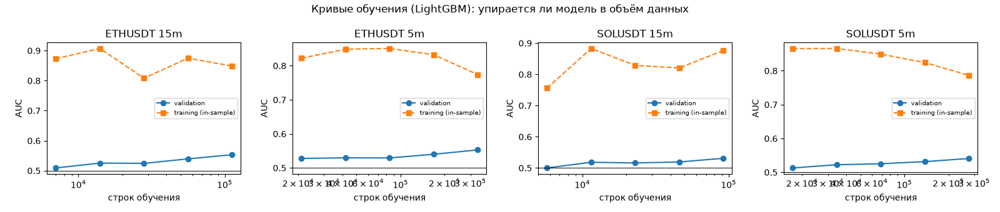
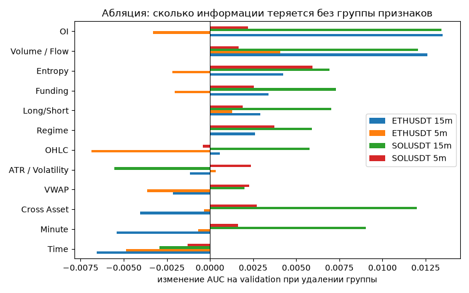
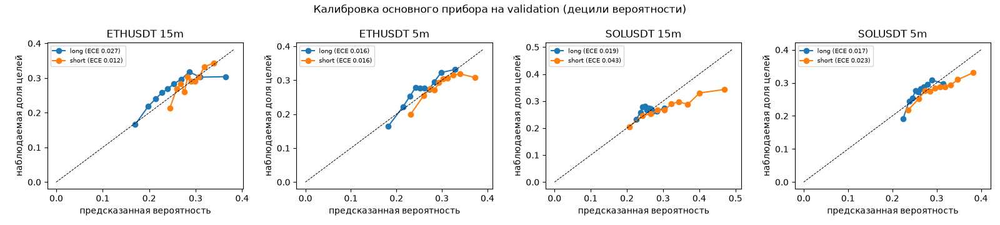

# Information Ceiling Study: сколько информации в текущих данных

Правило решения зафиксировано до запуска: `docs/stage-3-preregistration.md`. Training → validation, holdout не открывался. Модели — измерительные приборы, не стратегии.

## Ответ

**НЕДОСТАТОЧНО.** В текущем информационном пространстве (OHLCV + производные + OI + Funding + Long/Short + внутрибаровые признаки) достаточного сигнала для решения поставленной задачи не обнаружено.

## 1. Решающая таблица: лучшие сигналы дня, основной прибор (LightGBM), основная конфигурация

Цель 2R, стоп 1R, 1R = 2 ATR, издержки 0.14 % за круг. «Нижняя граница» — односторонний бутстреп по дням с поправкой Бонферрони (0.05/12). Требование: нижняя граница WR > 0.5 **и** нижняя граница EV > 0.

| Монета | ТФ | Сигналов в день | Сделок | WR | WR, нижн. | EV, R | EV, нижн. | Безубыточный WR | Выполнено |
|---|---|---|---|---|---|---|---|---|---|
| ETHUSDT | 15m | 1 | 547 | 0.329 | 0.278 | -0.142 | -0.315 | 0.390 | нет |
| ETHUSDT | 15m | 2 | 1094 | 0.310 | 0.272 | -0.174 | -0.287 | 0.390 | нет |
| ETHUSDT | 15m | 3 | 1641 | 0.308 | 0.274 | -0.172 | -0.275 | 0.390 | нет |
| ETHUSDT | 5m | 1 | 547 | 0.291 | 0.243 | -0.376 | -0.517 | 0.441 | нет |
| ETHUSDT | 5m | 2 | 1094 | 0.276 | 0.238 | -0.431 | -0.550 | 0.441 | нет |
| ETHUSDT | 5m | 3 | 1641 | 0.275 | 0.241 | -0.421 | -0.518 | 0.441 | нет |
| SOLUSDT | 15m | 1 | 547 | 0.400 | 0.344 | 0.135 | -0.032 | 0.373 | нет |
| SOLUSDT | 15m | 2 | 1094 | 0.355 | 0.313 | 0.023 | -0.110 | 0.373 | нет |
| SOLUSDT | 15m | 3 | 1641 | 0.346 | 0.309 | 0.005 | -0.101 | 0.373 | нет |
| SOLUSDT | 5m | 1 | 547 | 0.342 | 0.286 | -0.211 | -0.375 | 0.406 | нет |
| SOLUSDT | 5m | 2 | 1094 | 0.346 | 0.308 | -0.188 | -0.311 | 0.406 | нет |
| SOLUSDT | 5m | 3 | 1641 | 0.333 | 0.296 | -0.224 | -0.333 | 0.406 | нет |

## 2. Верхняя граница: все модели, все признаки

| Монета | ТФ | Конфигурация | Модель | AUC long [95% CI] | AUC short [95% CI] | WR топ-2/день | EV топ-2, R | Безубыточный WR | Доля целей (база) |
|---|---|---|---|---|---|---|---|---|---|
| ETHUSDT | 15m | 1R = 2 ATR | lightgbm | 0.5610 [0.542; 0.579] | 0.5456 [0.525; 0.564] | 0.310 | -0.174 | 0.390 | 0.265 |
| ETHUSDT | 15m | 1R = 2 ATR | xgboost | 0.5726 [0.548; 0.594] | 0.5487 [0.527; 0.570] | 0.326 | -0.143 | 0.390 | 0.265 |
| ETHUSDT | 15m | 1R = 2 ATR | catboost | 0.5630 [0.542; 0.587] | 0.5529 [0.530; 0.576] | 0.315 | -0.196 | 0.390 | 0.265 |
| ETHUSDT | 15m | 1R = 2 ATR | random_forest | 0.5732 [0.552; 0.593] | 0.5697 [0.550; 0.591] | 0.303 | -0.253 | 0.390 | 0.265 |
| ETHUSDT | 15m | 1R = 2 ATR | hist_gb | 0.5494 [0.527; 0.572] | 0.5335 [0.513; 0.556] | 0.388 | 0.074 | 0.390 | 0.265 |
| ETHUSDT | 15m | 1R = 2 ATR | mlp | 0.5378 [0.513; 0.561] | 0.5138 [0.489; 0.534] | 0.332 | -0.052 | 0.390 | 0.265 |
| ETHUSDT | 15m | 1R = 1 ATR | lightgbm | 0.5050 [0.491; 0.517] | 0.5153 [0.498; 0.531] | 0.329 | -0.345 | 0.447 | 0.333 |
| ETHUSDT | 5m | 1R = 2 ATR | lightgbm | 0.5622 [0.551; 0.575] | 0.5435 [0.532; 0.556] | 0.276 | -0.431 | 0.441 | 0.270 |
| ETHUSDT | 5m | 1R = 2 ATR | xgboost | 0.5602 [0.545; 0.573] | 0.5510 [0.539; 0.564] | 0.271 | -0.451 | 0.441 | 0.270 |
| ETHUSDT | 5m | 1R = 2 ATR | catboost | 0.5647 [0.552; 0.577] | 0.5519 [0.538; 0.567] | 0.311 | -0.421 | 0.441 | 0.270 |
| ETHUSDT | 5m | 1R = 2 ATR | random_forest | 0.5668 [0.554; 0.579] | 0.5663 [0.554; 0.578] | 0.324 | -0.415 | 0.441 | 0.270 |
| ETHUSDT | 5m | 1R = 2 ATR | hist_gb | 0.5376 [0.524; 0.552] | 0.5326 [0.519; 0.547] | 0.430 | -0.031 | 0.441 | 0.270 |
| ETHUSDT | 5m | 1R = 2 ATR | mlp | 0.5130 [0.500; 0.526] | 0.5142 [0.500; 0.528] | 0.345 | -0.205 | 0.441 | 0.270 |
| ETHUSDT | 5m | 1R = 1 ATR | lightgbm | 0.5003 [0.493; 0.507] | 0.5090 [0.503; 0.515] | 0.317 | -0.704 | 0.548 | 0.334 |
| SOLUSDT | 15m | 1R = 2 ATR | lightgbm | 0.5083 [0.484; 0.531] | 0.5536 [0.534; 0.574] | 0.355 | 0.023 | 0.373 | 0.267 |
| SOLUSDT | 15m | 1R = 2 ATR | xgboost | 0.5294 [0.509; 0.552] | 0.5553 [0.534; 0.577] | 0.325 | -0.069 | 0.373 | 0.267 |
| SOLUSDT | 15m | 1R = 2 ATR | catboost | 0.5378 [0.516; 0.560] | 0.5582 [0.538; 0.580] | 0.335 | -0.048 | 0.373 | 0.267 |
| SOLUSDT | 15m | 1R = 2 ATR | random_forest | 0.5434 [0.519; 0.568] | 0.5748 [0.555; 0.598] | 0.320 | -0.130 | 0.373 | 0.267 |
| SOLUSDT | 15m | 1R = 2 ATR | hist_gb | 0.4938 [0.473; 0.514] | 0.5275 [0.505; 0.548] | 0.438 | 0.291 | 0.373 | 0.267 |
| SOLUSDT | 15m | 1R = 2 ATR | mlp | 0.4934 [0.474; 0.513] | 0.5304 [0.510; 0.549] | 0.321 | -0.043 | 0.373 | 0.267 |
| SOLUSDT | 15m | 1R = 1 ATR | lightgbm | 0.5056 [0.494; 0.518] | 0.5077 [0.495; 0.519] | 0.350 | -0.190 | 0.412 | 0.331 |
| SOLUSDT | 5m | 1R = 2 ATR | lightgbm | 0.5425 [0.529; 0.555] | 0.5391 [0.526; 0.553] | 0.346 | -0.188 | 0.406 | 0.271 |
| SOLUSDT | 5m | 1R = 2 ATR | xgboost | 0.5462 [0.531; 0.558] | 0.5457 [0.532; 0.557] | 0.331 | -0.241 | 0.406 | 0.271 |
| SOLUSDT | 5m | 1R = 2 ATR | catboost | 0.5429 [0.529; 0.556] | 0.5388 [0.526; 0.551] | 0.291 | -0.367 | 0.406 | 0.271 |
| SOLUSDT | 5m | 1R = 2 ATR | random_forest | 0.5545 [0.541; 0.570] | 0.5524 [0.537; 0.565] | 0.313 | -0.327 | 0.406 | 0.271 |
| SOLUSDT | 5m | 1R = 2 ATR | hist_gb | 0.5350 [0.522; 0.548] | 0.5221 [0.508; 0.534] | 0.419 | 0.077 | 0.406 | 0.271 |
| SOLUSDT | 5m | 1R = 2 ATR | mlp | 0.5087 [0.496; 0.522] | 0.5085 [0.496; 0.521] | 0.362 | -0.044 | 0.406 | 0.271 |
| SOLUSDT | 5m | 1R = 1 ATR | lightgbm | 0.5025 [0.495; 0.510] | 0.5129 [0.506; 0.521] | 0.379 | -0.290 | 0.478 | 0.329 |

Случайный выбор 2 сигналов в день для сравнения (та же процедура, случайные оценки):

| Монета | ТФ | Конфигурация | WR | EV, R |
|---|---|---|---|---|
| ETHUSDT | 15m | r2 | 0.296 | -0.125 |
| ETHUSDT | 15m | r1 | 0.318 | -0.379 |
| ETHUSDT | 5m | r2 | 0.280 | -0.272 |
| ETHUSDT | 5m | r1 | 0.340 | -0.606 |
| SOLUSDT | 15m | r2 | 0.293 | -0.075 |
| SOLUSDT | 15m | r1 | 0.354 | -0.170 |
| SOLUSDT | 5m | r2 | 0.295 | -0.154 |
| SOLUSDT | 5m | r1 | 0.314 | -0.484 |

Точность на самых уверенных долях validation (основной прибор, long):

| Монета | ТФ | Топ-доля | N | Precision | Recall | EV, R |
|---|---|---|---|---|---|---|
| ETHUSDT | 15m | 0.1% | 52 | 0.346 | 0.001 | -0.226 |
| ETHUSDT | 15m | 0.5% | 262 | 0.385 | 0.007 | -0.096 |
| ETHUSDT | 15m | 1.0% | 524 | 0.384 | 0.014 | -0.065 |
| ETHUSDT | 15m | 5.0% | 2623 | 0.301 | 0.057 | -0.266 |
| ETHUSDT | 15m | 10.0% | 5246 | 0.304 | 0.115 | -0.238 |
| ETHUSDT | 5m | 0.1% | 157 | 0.446 | 0.002 | 0.169 |
| ETHUSDT | 5m | 0.5% | 787 | 0.367 | 0.007 | -0.170 |
| ETHUSDT | 5m | 1.0% | 1574 | 0.349 | 0.013 | -0.258 |
| ETHUSDT | 5m | 5.0% | 7874 | 0.340 | 0.063 | -0.293 |
| ETHUSDT | 5m | 10.0% | 15748 | 0.331 | 0.123 | -0.311 |
| SOLUSDT | 15m | 0.1% | 52 | 0.327 | 0.001 | -0.151 |
| SOLUSDT | 15m | 0.5% | 262 | 0.240 | 0.005 | -0.425 |
| SOLUSDT | 15m | 1.0% | 524 | 0.307 | 0.012 | -0.185 |
| SOLUSDT | 15m | 5.0% | 2623 | 0.283 | 0.053 | -0.200 |
| SOLUSDT | 15m | 10.0% | 5246 | 0.274 | 0.103 | -0.200 |
| SOLUSDT | 5m | 0.1% | 157 | 0.166 | 0.001 | -0.736 |
| SOLUSDT | 5m | 0.5% | 787 | 0.254 | 0.005 | -0.478 |
| SOLUSDT | 5m | 1.0% | 1574 | 0.297 | 0.011 | -0.339 |
| SOLUSDT | 5m | 5.0% | 7874 | 0.301 | 0.055 | -0.284 |
| SOLUSDT | 5m | 10.0% | 15748 | 0.298 | 0.110 | -0.260 |

## 3. Кривые обучения

Если AUC на validation растёт с объёмом обучения — модель упирается в данные; если плато — в отсутствие информации.

| Монета | ТФ | Доля | Строк | AUC val | AUC train |
|---|---|---|---|---|---|
| ETHUSDT | 15m | 0.0625 | 7006 | 0.5092 | 0.8729 |
| ETHUSDT | 15m | 0.125 | 14013 | 0.5254 | 0.9072 |
| ETHUSDT | 15m | 0.25 | 28026 | 0.5245 | 0.8083 |
| ETHUSDT | 15m | 0.5 | 56053 | 0.5395 | 0.8747 |
| ETHUSDT | 15m | 1.0 | 112106 | 0.5533 | 0.8488 |
| ETHUSDT | 5m | 0.0625 | 21032 | 0.5279 | 0.8221 |
| ETHUSDT | 5m | 0.125 | 42064 | 0.5298 | 0.8485 |
| ETHUSDT | 5m | 0.25 | 84129 | 0.5294 | 0.8507 |
| ETHUSDT | 5m | 0.5 | 168258 | 0.5401 | 0.8323 |
| ETHUSDT | 5m | 1.0 | 336516 | 0.5528 | 0.7741 |
| SOLUSDT | 15m | 0.0625 | 5742 | 0.5000 | 0.7561 |
| SOLUSDT | 15m | 0.125 | 11485 | 0.5183 | 0.8830 |
| SOLUSDT | 15m | 0.25 | 22971 | 0.5160 | 0.8288 |
| SOLUSDT | 15m | 0.5 | 45942 | 0.5192 | 0.8207 |
| SOLUSDT | 15m | 1.0 | 91885 | 0.5309 | 0.8763 |
| SOLUSDT | 5m | 0.0625 | 17250 | 0.5129 | 0.8656 |
| SOLUSDT | 5m | 0.125 | 34500 | 0.5224 | 0.8658 |
| SOLUSDT | 5m | 0.25 | 69001 | 0.5253 | 0.8492 |
| SOLUSDT | 5m | 0.5 | 138003 | 0.5316 | 0.8241 |
| SOLUSDT | 5m | 1.0 | 276007 | 0.5408 | 0.7863 |

## 4. Абляция: сколько информации теряется без группы

| Группа | Признаков | Δ AUC ETH 15m | Δ AUC ETH 5m | Δ AUC SOL 15m | Δ AUC SOL 5m |
|---|---|---|---|---|---|
| Funding | 3 | +0.0034 | -0.0020 | +0.0073 | +0.0025 |
| Long/Short | 3 | +0.0029 | +0.0013 | +0.0070 | +0.0019 |
| OHLC | 135 | +0.0006 | -0.0069 | +0.0058 | -0.0004 |
| ATR / Volatility | 31 | -0.0011 | +0.0003 | -0.0056 | +0.0024 |
| Cross Asset | 39 | -0.0040 | -0.0003 | +0.0120 | +0.0027 |
| Volume / Flow | 38 | +0.0126 | +0.0041 | +0.0121 | +0.0017 |
| OI | 9 | +0.0135 | -0.0033 | +0.0134 | +0.0022 |
| VWAP | 10 | -0.0021 | -0.0036 | +0.0020 | +0.0023 |
| Minute | 11 | -0.0054 | -0.0007 | +0.0090 | +0.0016 |
| Entropy | 9 | +0.0043 | -0.0022 | +0.0069 | +0.0059 |
| Regime | 16 | +0.0026 | +0.0000 | +0.0059 | +0.0037 |
| Time | 19 | -0.0066 | -0.0049 | -0.0029 | -0.0013 |

## 5. Важность признаков: четыре метода

### ETHUSDT 15m

Согласие методов (ранговая корреляция по признакам, где посчитаны оба):

|  | gain | shap | permutation | mutual_info |
|---|---|---|---|---|
| gain | 1.00 | 0.97 | -0.09 | 0.50 |
| shap | 0.97 | 1.00 | 0.11 | 0.48 |
| permutation | -0.09 | 0.11 | 1.00 | -0.02 |
| mutual_info | 0.50 | 0.48 | -0.02 | 1.00 |

| Ранг | gain | shap | permutation | mutual_info |
|---|---|---|---|---|
| 1 | `cl_hours_to_weekly_expiry` | `vl_atr_pctl_7d` | `po_ls_accounts_chg_24` | `cp_range_ratio_96` |
| 2 | `st_skew_288` | `cl_hours_to_weekly_expiry` | `tm_min_since_ny_open` | `po_funding_chg` |
| 3 | `vl_atr_pctl_7d` | `st_skew_288` | `cx_sol_beta_96` | `po_funding` |
| 4 | `fr_scaling_24_288` | `po_ls_accounts_chg_24` | `cx_btc_beta_288` | `cp_range_ratio_24` |
| 5 | `mi_impact_per_volume_288` | `tm_min_since_ny_open` | `ds_high_7d` | `po_funding_z_30d` |
| 6 | `vl_rv_288` | `en_volume_96` | `ps_age_high_288` | `lq_amihud_288` |
| 7 | `en_volume_96` | `po_oi_price_corr_288` | `vw_above_frac_96` | `vl_rv_288` |
| 8 | `ex_days_since_high_vol` | `vl_rogers_satchell_24` | `vl_rogers_satchell_24` | `en_permutation_288` |
| 9 | `tm_min_since_ny_open` | `mi_impact_per_volume_288` | `cx_btc_beta_96` | `rl_min_r_288` |
| 10 | `rl_min_r_288` | `cx_btc_beta_96` | `rl_max_r_288` | `rl_max_r_288` |

Доля SHAP по группам: OHLC 26%, ATR / Volatility 16%, Cross Asset 13%, Time 11%, Volume / Flow 9%, VWAP 5%, OI 5%, Long/Short 4%, Entropy 4%, Minute 3%, Regime 3%, Funding 1%

### ETHUSDT 5m

Согласие методов (ранговая корреляция по признакам, где посчитаны оба):

|  | gain | shap | permutation | mutual_info |
|---|---|---|---|---|
| gain | 1.00 | 0.97 | 0.36 | 0.30 |
| shap | 0.97 | 1.00 | 0.36 | 0.30 |
| permutation | 0.36 | 0.36 | 1.00 | -0.13 |
| mutual_info | 0.30 | 0.30 | -0.13 | 1.00 |

| Ранг | gain | shap | permutation | mutual_info |
|---|---|---|---|---|
| 1 | `cp_days_since_low_vol` | `po_ls_accounts` | `vw_day_dist` | `cp_range_ratio_96` |
| 2 | `vl_atr_pctl_7d` | `vw_day_slope_6` | `vw_day_slope_6` | `po_funding_chg` |
| 3 | `cp_range_ratio_96` | `vw_day_dist` | `cp_days_since_low_vol` | `po_funding` |
| 4 | `tm_min_since_utc_midnight` | `tm_min_since_utc_midnight` | `ds_low_7d` | `po_funding_z_30d` |
| 5 | `ex_days_since_high_vol` | `cp_range_ratio_96` | `vl_rv_288` | `cp_range_ratio_24` |
| 6 | `vw_day_slope_6` | `vl_atr_pctl_7d` | `ds_high_7d` | `cp_days_since_low_vol` |
| 7 | `cl_hours_to_weekly_expiry` | `vo_trend` | `vo_trend` | `vl_semivar_ratio_288` |
| 8 | `mr_half_life_288` | `ds_low_7d` | `vl_atr_pctl_90d` | `vl_rv_288` |
| 9 | `po_ls_accounts` | `cl_hours_to_weekly_expiry` | `vl_rogers_satchell_24` | `lq_amihud_288` |
| 10 | `tm_min_since_ny_open` | `tm_min_since_london_open` | `po_funding_z_30d` | `rl_min_r_288` |

Доля SHAP по группам: OHLC 24%, ATR / Volatility 19%, Time 14%, VWAP 12%, Volume / Flow 10%, Cross Asset 5%, Long/Short 5%, Regime 3%, Funding 2%, Entropy 2%, OI 2%, Minute 1%

### SOLUSDT 15m

Согласие методов (ранговая корреляция по признакам, где посчитаны оба):

|  | gain | shap | permutation | mutual_info |
|---|---|---|---|---|
| gain | 1.00 | 0.98 | 0.06 | 0.46 |
| shap | 0.98 | 1.00 | 0.10 | 0.44 |
| permutation | 0.06 | 0.10 | 1.00 | 0.04 |
| mutual_info | 0.46 | 0.44 | 0.04 | 1.00 |

| Ранг | gain | shap | permutation | mutual_info |
|---|---|---|---|---|
| 1 | `vo_absr_corr_288` | `mr_z_sma_96` | `mr_z_sma_96` | `cp_range_ratio_96` |
| 2 | `lq_depth_proxy_96` | `ps_age_low_96` | `tm_min_since_ny_open` | `po_funding_chg` |
| 3 | `rl_min_r_288` | `lq_amihud_288` | `fr_scaling_24_288` | `po_funding` |
| 4 | `rl_max_r_288` | `tm_min_since_ny_open` | `rg_trend_tstat_288` | `cp_range_ratio_24` |
| 5 | `cl_day_of_month` | `st_skew_96` | `ps_age_low_96` | `po_funding_z_30d` |
| 6 | `mr_half_life_288` | `po_oi_price_corr_96` | `rl_min_r_288` | `lq_amihud_288` |
| 7 | `lq_amihud_288` | `of_taker_share_96` | `en_volume_96` | `vl_rv_288` |
| 8 | `cl_hours_to_weekly_expiry` | `rl_min_r_288` | `ex_atr_ratio_14_100` | `en_permutation_288` |
| 9 | `tm_min_since_ny_open` | `cx_eth_beta_288` | `mr_half_life_288` | `cp_days_since_low_vol` |
| 10 | `po_ls_accounts` | `cl_day_of_month` | `cx_eth_beta_96` | `rl_max_r_288` |

Доля SHAP по группам: OHLC 35%, Volume / Flow 17%, Cross Asset 13%, Time 10%, ATR / Volatility 8%, Regime 5%, OI 4%, Long/Short 3%, VWAP 3%, Entropy 2%, Minute 2%, Funding 0%

### SOLUSDT 5m

Согласие методов (ранговая корреляция по признакам, где посчитаны оба):

|  | gain | shap | permutation | mutual_info |
|---|---|---|---|---|
| gain | 1.00 | 0.98 | 0.10 | 0.32 |
| shap | 0.98 | 1.00 | 0.40 | 0.30 |
| permutation | 0.10 | 0.40 | 1.00 | 0.11 |
| mutual_info | 0.32 | 0.30 | 0.11 | 1.00 |

| Ранг | gain | shap | permutation | mutual_info |
|---|---|---|---|---|
| 1 | `vo_absr_corr_288` | `ex_atr_ratio_14_100` | `rg_trend_tstat_288` | `cp_range_ratio_96` |
| 2 | `rl_min_r_288` | `mr_z_sma_288` | `cp_range_ratio_96` | `po_funding_chg` |
| 3 | `cp_range_ratio_96` | `cp_range_ratio_96` | `ds_high_7d` | `po_funding` |
| 4 | `po_funding_z_30d` | `ps_dist_low_288` | `ps_age_low_288` | `po_funding_z_30d` |
| 5 | `lq_amihud_288` | `ps_age_high_288` | `st_skew_288` | `cp_range_ratio_24` |
| 6 | `cx_eth_beta_288` | `rs_btc_ratio_trend` | `ex_atr_ratio_14_100` | `rl_min_r_288` |
| 7 | `po_funding_chg` | `lq_amihud_288` | `ps_dist_low_288` | `cp_days_since_low_vol` |
| 8 | `ds_high_7d` | `ps_range_288` | `po_funding_chg` | `lq_amihud_288` |
| 9 | `lq_depth_proxy_96` | `rg_trend_tstat_288` | `vl_rogers_satchell_24` | `ds_drawdown_from_max` |
| 10 | `vl_vol_of_vol_288` | `gp_max_gap_288` | `ps_age_high_288` | `vl_rv_288` |

Доля SHAP по группам: OHLC 33%, ATR / Volatility 16%, Volume / Flow 15%, Cross Asset 11%, Time 7%, Regime 4%, VWAP 4%, Funding 4%, OI 2%, Entropy 2%, Long/Short 2%, Minute 1%

## 6. Калибровка

| Монета | ТФ | Направление | Доля целей | Brier | ECE |
|---|---|---|---|---|---|
| ETHUSDT | 15m | long | 0.265 | 0.1940 | 0.0267 |
| ETHUSDT | 15m | short | 0.289 | 0.2043 | 0.0124 |
| ETHUSDT | 5m | long | 0.270 | 0.1951 | 0.0164 |
| ETHUSDT | 5m | short | 0.284 | 0.2027 | 0.0155 |
| SOLUSDT | 15m | long | 0.267 | 0.1958 | 0.0187 |
| SOLUSDT | 15m | short | 0.279 | 0.2028 | 0.0431 |
| SOLUSDT | 5m | long | 0.271 | 0.1968 | 0.0174 |
| SOLUSDT | 5m | short | 0.281 | 0.2020 | 0.0228 |

## 7. Проверки исправности

| Монета | ТФ | AUC на перемешанных метках | AUC со встроенным эффектом | AUC без знания эффекта | Ранг встроенной колонки (SHAP) | Лучший ранг случайного признака | Пройдено |
|---|---|---|---|---|---|---|---|
| ETHUSDT | 15m | 0.4984 | 0.6259 | 0.5565 | 1 | 265 | да |
| ETHUSDT | 5m | 0.5020 | 0.6036 | 0.5560 | 1 | 264 | да |
| SOLUSDT | 15m | 0.5017 | 0.5647 | 0.5076 | 1 | 204 | да |
| SOLUSDT | 5m | 0.5007 | 0.5984 | 0.5399 | 1 | 262 | да |
