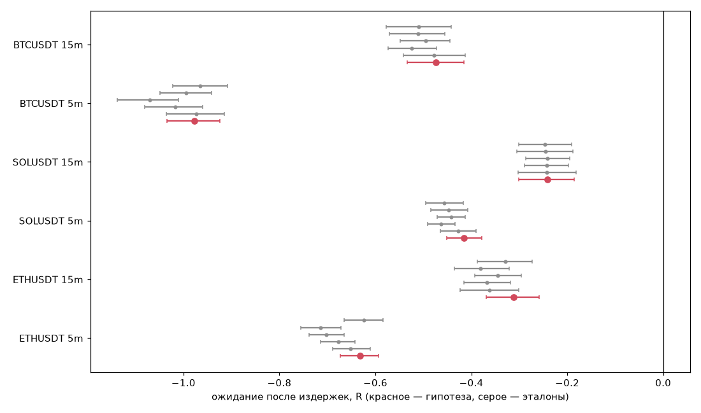

# H002: Продолжение после свипа — проверка на validation

Период: 2024-01-01 — 2025-07-01. Замок гипотезы `3951b72e9ef68c53`. Сформировано 2026-10-30 09:16 UTC.

> Расчёт исследовательский, не торговая рекомендация.

## Вердикт: ОТКЛОНЕНО

ETHUSDT 5m: E после издержек -0.632R, CI [-0.674; -0.593]; ETHUSDT 15m: E после издержек -0.311R, CI [-0.369; -0.258]; SOLUSDT 5m: E после издержек -0.415R, CI [-0.451; -0.378]; SOLUSDT 15m: E после издержек -0.242R, CI [-0.300; -0.185]

Событие `liquidity_sweep` {'cooldown': 12, 'lookback': 24, 'min_age': 3, 'depth_atr': 0.1}, направление `with`, фильтры: нет; исход: цель 1.0R / стоп 1R, 1R = 1.0 ATR, горизонт 24 баров.

| Монета | ТФ | Сделок | Win rate | E после издержек, R | 95% CI | Эффект до издержек vs случайный, R | CI эффекта | Пройдено |
|---|---|---|---|---|---|---|---|---|
| ETHUSDT | 5m | 3359 | 0.444 | -0.632 | [-0.674; -0.593] | 0.037 | [-0.008; 0.087] | нет |
| ETHUSDT | 15m | 1208 | 0.519 | -0.311 | [-0.369; -0.258] | 0.061 | [-0.015; 0.143] | нет |
| SOLUSDT | 5m | 3180 | 0.512 | -0.415 | [-0.451; -0.378] | 0.023 | [-0.023; 0.069] | нет |
| SOLUSDT | 15m | 1165 | 0.502 | -0.242 | [-0.300; -0.185] | 0.009 | [-0.069; 0.091] | нет |
| BTCUSDT | 5m | 3216 | 0.309 | -0.977 | [-1.034; -0.924] | 0.015 | [-0.031; 0.064] | нет |
| BTCUSDT | 15m | 1188 | 0.488 | -0.474 | [-0.534; -0.416] | 0.026 | [-0.050; 0.100] | нет |

## Сравнение с эталонами (ΔE = гипотеза − эталон, после издержек)

| Монета | ТФ | Эталон | N | E эталона | ΔE | 95% CI | p (BH) | Cliff's δ | Тест |
|---|---|---|---|---|---|---|---|---|---|
| ETHUSDT | 5m | random_entry | 3359 | -0.652 | 0.019 | [-0.029; 0.068] | 0.7699 | 0.001 | permutation (разница средних) |
| ETHUSDT | 5m | mean_reversion | 5359 | -0.677 | 0.045 | [-0.003; 0.092] | 0.2639 | 0.026 | permutation (разница средних) |
| ETHUSDT | 5m | momentum | 5359 | -0.702 | 0.070 | [0.028; 0.114] | 0.0100 | 0.038 | permutation (разница средних) |
| ETHUSDT | 5m | buy_every_sweep | 3359 | -0.714 | 0.082 | [0.033; 0.133] | 0.0100 | 0.042 | permutation (разница средних) |
| ETHUSDT | 5m | sell_every_sweep | 3359 | -0.623 | -0.009 | [-0.057; 0.039] | 0.9308 | -0.005 | permutation (разница средних) |
| ETHUSDT | 15m | random_entry | 1208 | -0.362 | 0.051 | [-0.034; 0.125] | 0.5282 | 0.010 | permutation (разница средних) |
| ETHUSDT | 15m | mean_reversion | 1672 | -0.367 | 0.056 | [-0.023; 0.133] | 0.4581 | 0.024 | permutation (разница средних) |
| ETHUSDT | 15m | momentum | 1672 | -0.345 | 0.034 | [-0.034; 0.102] | 0.7496 | 0.013 | permutation (разница средних) |
| ETHUSDT | 15m | buy_every_sweep | 1208 | -0.381 | 0.070 | [-0.010; 0.147] | 0.4219 | 0.034 | permutation (разница средних) |
| ETHUSDT | 15m | sell_every_sweep | 1208 | -0.329 | 0.018 | [-0.059; 0.097] | 0.9289 | 0.010 | permutation (разница средних) |
| SOLUSDT | 5m | random_entry | 3180 | -0.427 | 0.012 | [-0.035; 0.061] | 0.9289 | -0.008 | permutation (разница средних) |
| SOLUSDT | 5m | mean_reversion | 5447 | -0.463 | 0.048 | [0.003; 0.094] | 0.2639 | 0.024 | permutation (разница средних) |
| SOLUSDT | 5m | momentum | 5447 | -0.442 | 0.028 | [-0.014; 0.069] | 0.5282 | 0.014 | permutation (разница средних) |
| SOLUSDT | 5m | buy_every_sweep | 3180 | -0.447 | 0.032 | [-0.020; 0.080] | 0.5234 | 0.016 | permutation (разница средних) |
| SOLUSDT | 5m | sell_every_sweep | 3180 | -0.456 | 0.042 | [-0.007; 0.090] | 0.4219 | 0.021 | permutation (разница средних) |
| SOLUSDT | 15m | random_entry | 1165 | -0.243 | 0.001 | [-0.081; 0.084] | 0.9940 | -0.020 | permutation (разница средних) |
| SOLUSDT | 15m | mean_reversion | 1734 | -0.243 | 0.001 | [-0.072; 0.078] | 0.9940 | -0.012 | permutation (разница средних) |
| SOLUSDT | 15m | momentum | 1734 | -0.242 | -0.000 | [-0.074; 0.070] | 0.9940 | -0.012 | permutation (разница средних) |
| SOLUSDT | 15m | buy_every_sweep | 1165 | -0.245 | 0.003 | [-0.077; 0.084] | 0.9940 | 0.002 | permutation (разница средних) |
| SOLUSDT | 15m | sell_every_sweep | 1165 | -0.246 | 0.005 | [-0.073; 0.083] | 0.9940 | 0.002 | permutation (разница средних) |
| BTCUSDT | 5m | random_entry | 3216 | -0.973 | -0.004 | [-0.055; 0.051] | 0.9940 | -0.009 | permutation (разница средних) |
| BTCUSDT | 5m | mean_reversion | 5918 | -1.017 | 0.040 | [-0.012; 0.092] | 0.4479 | 0.018 | permutation (разница средних) |
| BTCUSDT | 5m | momentum | 5918 | -1.070 | 0.094 | [0.043; 0.147] | 0.0100 | 0.042 | permutation (разница средних) |
| BTCUSDT | 5m | buy_every_sweep | 3216 | -0.995 | 0.018 | [-0.030; 0.065] | 0.8871 | 0.010 | permutation (разница средних) |
| BTCUSDT | 5m | sell_every_sweep | 3216 | -0.965 | -0.012 | [-0.056; 0.034] | 0.9289 | -0.006 | permutation (разница средних) |
| BTCUSDT | 15m | random_entry | 1188 | -0.478 | 0.004 | [-0.073; 0.083] | 0.9940 | -0.010 | permutation (разница средних) |
| BTCUSDT | 15m | mean_reversion | 1724 | -0.525 | 0.051 | [-0.020; 0.123] | 0.5234 | 0.026 | permutation (разница средних) |
| BTCUSDT | 15m | momentum | 1724 | -0.496 | 0.022 | [-0.051; 0.089] | 0.9059 | 0.011 | permutation (разница средних) |
| BTCUSDT | 15m | buy_every_sweep | 1188 | -0.511 | 0.037 | [-0.040; 0.115] | 0.7496 | 0.020 | permutation (разница средних) |
| BTCUSDT | 15m | sell_every_sweep | 1188 | -0.510 | 0.035 | [-0.044; 0.115] | 0.7496 | 0.017 | permutation (разница средних) |

## Режимы рынка (описательно; режим-специфичный эффект = новая гипотеза)

| Монета | ТФ | Ось | Режим | N | E net | E gross | E случайный | Δ vs случ. | 95% CI |
|---|---|---|---|---|---|---|---|---|---|
| ETHUSDT | 5m | trend | range | 1701 | -0.680 | 0.050 | -0.695 | 0.015 | [-0.054; 0.087] |
| ETHUSDT | 5m | trend | trend | 1658 | -0.583 | 0.022 | -0.605 | 0.022 | [-0.045; 0.089] |
| ETHUSDT | 5m | vol | high_vol | 1637 | -0.450 | 0.009 | -0.453 | 0.003 | [-0.068; 0.078] |
| ETHUSDT | 5m | vol | low_vol | 1722 | -0.805 | 0.062 | -0.840 | 0.035 | [-0.028; 0.098] |
| ETHUSDT | 5m | btc | btc_strong | 1759 | -0.673 | 0.024 | -0.690 | 0.017 | [-0.046; 0.082] |
| ETHUSDT | 5m | btc | btc_weak | 1600 | -0.587 | 0.049 | -0.605 | 0.017 | [-0.048; 0.090] |
| ETHUSDT | 5m | risk | risk_off | 1518 | -0.620 | 0.025 | -0.621 | 0.001 | [-0.068; 0.072] |
| ETHUSDT | 5m | risk | risk_on | 1841 | -0.643 | 0.045 | -0.675 | 0.033 | [-0.030; 0.097] |
| ETHUSDT | 15m | trend | range | 600 | -0.330 | 0.059 | -0.413 | 0.083 | [-0.036; 0.203] |
| ETHUSDT | 15m | trend | trend | 608 | -0.293 | 0.026 | -0.312 | 0.019 | [-0.095; 0.131] |
| ETHUSDT | 15m | vol | high_vol | 591 | -0.183 | 0.074 | -0.237 | 0.054 | [-0.060; 0.167] |
| ETHUSDT | 15m | vol | low_vol | 617 | -0.434 | 0.013 | -0.482 | 0.048 | [-0.061; 0.154] |
| ETHUSDT | 15m | btc | btc_strong | 638 | -0.374 | -0.008 | -0.391 | 0.017 | [-0.087; 0.123] |
| ETHUSDT | 15m | btc | btc_weak | 570 | -0.241 | 0.099 | -0.330 | 0.088 | [-0.024; 0.205] |
| ETHUSDT | 15m | risk | risk_off | 534 | -0.287 | 0.048 | -0.315 | 0.028 | [-0.089; 0.150] |
| ETHUSDT | 15m | risk | risk_on | 674 | -0.331 | 0.039 | -0.398 | 0.067 | [-0.039; 0.178] |
| SOLUSDT | 5m | trend | range | 1590 | -0.461 | 0.019 | -0.443 | -0.018 | [-0.089; 0.051] |
| SOLUSDT | 5m | trend | trend | 1590 | -0.368 | 0.053 | -0.410 | 0.042 | [-0.029; 0.109] |
| SOLUSDT | 5m | vol | high_vol | 1512 | -0.299 | 0.031 | -0.328 | 0.029 | [-0.037; 0.097] |
| SOLUSDT | 5m | vol | low_vol | 1668 | -0.520 | 0.041 | -0.517 | -0.003 | [-0.066; 0.061] |
| SOLUSDT | 5m | btc | btc_strong | 1687 | -0.457 | 0.015 | -0.483 | 0.026 | [-0.035; 0.085] |
| SOLUSDT | 5m | btc | btc_weak | 1493 | -0.367 | 0.060 | -0.366 | -0.001 | [-0.071; 0.075] |
| SOLUSDT | 5m | risk | risk_off | 1444 | -0.343 | 0.082 | -0.374 | 0.030 | [-0.040; 0.100] |
| SOLUSDT | 5m | risk | risk_on | 1736 | -0.474 | -0.002 | -0.467 | -0.007 | [-0.069; 0.055] |
| SOLUSDT | 15m | trend | range | 577 | -0.235 | 0.019 | -0.230 | -0.006 | [-0.121; 0.108] |
| SOLUSDT | 15m | trend | trend | 588 | -0.248 | -0.010 | -0.257 | 0.009 | [-0.111; 0.126] |
| SOLUSDT | 15m | vol | high_vol | 555 | -0.190 | -0.006 | -0.166 | -0.025 | [-0.137; 0.089] |
| SOLUSDT | 15m | vol | low_vol | 610 | -0.289 | 0.013 | -0.313 | 0.025 | [-0.090; 0.147] |
| SOLUSDT | 15m | btc | btc_strong | 605 | -0.289 | -0.031 | -0.276 | -0.013 | [-0.121; 0.103] |
| SOLUSDT | 15m | btc | btc_weak | 560 | -0.191 | 0.042 | -0.205 | 0.015 | [-0.118; 0.140] |
| SOLUSDT | 15m | risk | risk_off | 538 | -0.187 | 0.044 | -0.238 | 0.051 | [-0.069; 0.180] |
| SOLUSDT | 15m | risk | risk_on | 627 | -0.289 | -0.030 | -0.247 | -0.042 | [-0.157; 0.069] |
| BTCUSDT | 5m | trend | range | 1577 | -1.096 | 0.009 | -1.076 | -0.020 | [-0.098; 0.061] |
| BTCUSDT | 5m | trend | trend | 1639 | -0.861 | -0.004 | -0.853 | -0.008 | [-0.083; 0.068] |
| BTCUSDT | 5m | vol | high_vol | 1605 | -0.597 | 0.009 | -0.603 | 0.006 | [-0.063; 0.071] |
| BTCUSDT | 5m | vol | low_vol | 1611 | -1.355 | -0.005 | -1.341 | -0.013 | [-0.089; 0.064] |
| BTCUSDT | 5m | btc | btc_strong | 1691 | -1.039 | -0.014 | -1.001 | -0.038 | [-0.114; 0.034] |
| BTCUSDT | 5m | btc | btc_weak | 1525 | -0.907 | 0.020 | -0.943 | 0.035 | [-0.044; 0.115] |
| BTCUSDT | 5m | risk | risk_off | 1456 | -0.944 | -0.015 | -0.913 | -0.031 | [-0.117; 0.048] |
| BTCUSDT | 5m | risk | risk_on | 1760 | -1.003 | 0.016 | -1.020 | 0.017 | [-0.048; 0.082] |
| BTCUSDT | 15m | trend | range | 587 | -0.497 | 0.061 | -0.511 | 0.014 | [-0.102; 0.127] |
| BTCUSDT | 15m | trend | trend | 601 | -0.452 | 0.009 | -0.445 | -0.007 | [-0.115; 0.100] |
| BTCUSDT | 15m | vol | high_vol | 593 | -0.346 | -0.004 | -0.304 | -0.042 | [-0.155; 0.071] |
| BTCUSDT | 15m | vol | low_vol | 595 | -0.602 | 0.073 | -0.652 | 0.050 | [-0.066; 0.165] |
| BTCUSDT | 15m | btc | btc_strong | 629 | -0.472 | 0.049 | -0.562 | 0.090 | [-0.024; 0.200] |
| BTCUSDT | 15m | btc | btc_weak | 559 | -0.476 | 0.019 | -0.379 | -0.097 | [-0.210; 0.021] |
| BTCUSDT | 15m | risk | risk_off | 539 | -0.457 | 0.036 | -0.398 | -0.058 | [-0.185; 0.060] |
| BTCUSDT | 15m | risk | risk_on | 649 | -0.489 | 0.033 | -0.537 | 0.049 | [-0.049; 0.151] |

## Причины по рынкам

- ETHUSDT 5m: E после издержек -0.632R, CI [-0.674; -0.593]; не лучше random_entry (Δ +0.019R); не лучше mean_reversion (Δ +0.045R); не лучше sell_every_sweep (Δ -0.009R)
- ETHUSDT 15m: E после издержек -0.311R, CI [-0.369; -0.258]; не лучше random_entry (Δ +0.051R); не лучше mean_reversion (Δ +0.056R); не лучше momentum (Δ +0.034R); не лучше buy_every_sweep (Δ +0.070R); не лучше sell_every_sweep (Δ +0.018R)
- SOLUSDT 5m: E после издержек -0.415R, CI [-0.451; -0.378]; не лучше random_entry (Δ +0.012R); не лучше mean_reversion (Δ +0.048R); не лучше momentum (Δ +0.028R); не лучше buy_every_sweep (Δ +0.032R); не лучше sell_every_sweep (Δ +0.042R)
- SOLUSDT 15m: E после издержек -0.242R, CI [-0.300; -0.185]; не лучше random_entry (Δ +0.001R); не лучше mean_reversion (Δ +0.001R); не лучше momentum (Δ -0.000R); не лучше buy_every_sweep (Δ +0.003R); не лучше sell_every_sweep (Δ +0.005R)
- BTCUSDT 5m: E после издержек -0.977R, CI [-1.034; -0.924]; не лучше random_entry (Δ -0.004R); не лучше mean_reversion (Δ +0.040R); не лучше buy_every_sweep (Δ +0.018R); не лучше sell_every_sweep (Δ -0.012R)
- BTCUSDT 15m: E после издержек -0.474R, CI [-0.534; -0.416]; не лучше random_entry (Δ +0.004R); не лучше mean_reversion (Δ +0.051R); не лучше momentum (Δ +0.022R); не лучше buy_every_sweep (Δ +0.037R); не лучше sell_every_sweep (Δ +0.035R)

## Счётчики

| Монета | ТФ | events_all_history | events_in_period | after_filters | trades_with_outcome | baseline_random_entry | baseline_mean_reversion | baseline_momentum | baseline_buy_every_sweep | baseline_sell_every_sweep |
|---|---|---|---|---|---|---|---|---|---|---|
| ETHUSDT | 5m | 15090 | 3359 | 3359 | 3359 | 3359 | 5359 | 5359 | 3359 | 3359 |
| ETHUSDT | 15m | 5533 | 1208 | 1208 | 1208 | 1208 | 1672 | 1672 | 1208 | 1208 |
| SOLUSDT | 5m | 13032 | 3180 | 3180 | 3180 | 3180 | 5447 | 5447 | 3180 | 3180 |
| SOLUSDT | 15m | 4616 | 1165 | 1165 | 1165 | 1165 | 1734 | 1734 | 1165 | 1165 |
| BTCUSDT | 5m | 15488 | 3216 | 3216 | 3216 | 3216 | 5918 | 5918 | 3216 | 3216 |
| BTCUSDT | 15m | 5714 | 1188 | 1188 | 1188 | 1188 | 1724 | 1724 | 1188 | 1188 |
