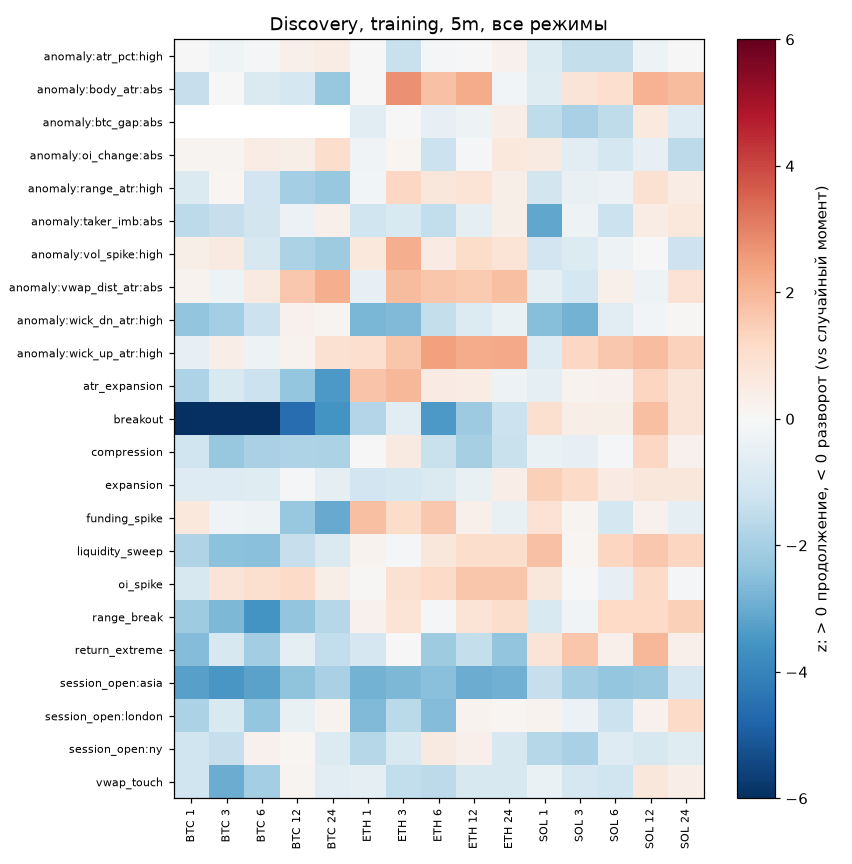
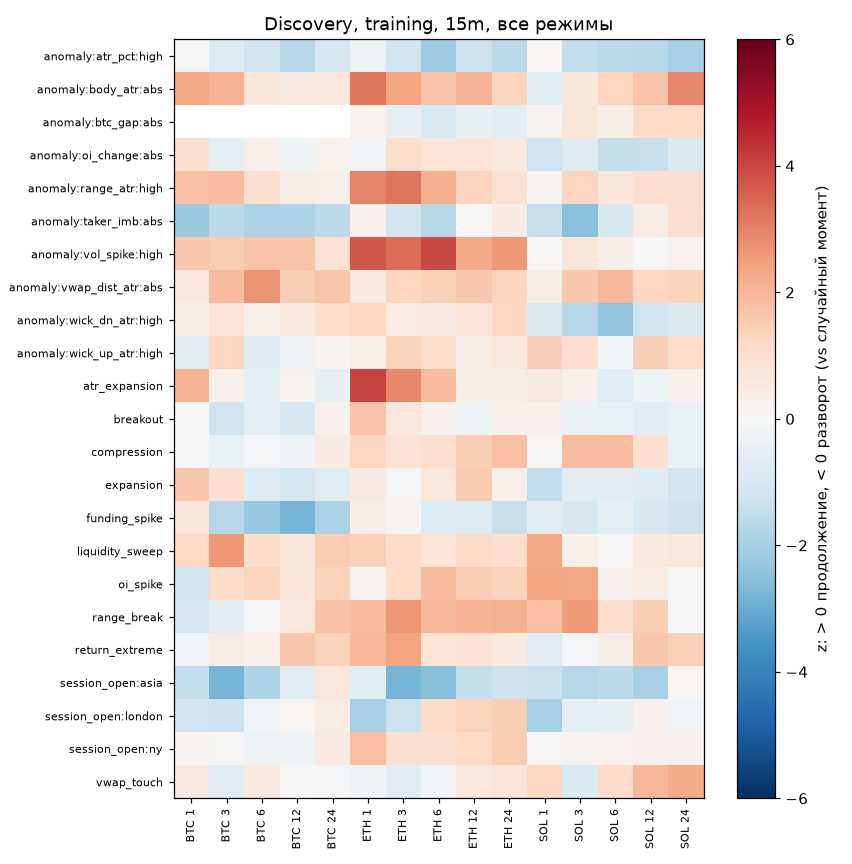

# Discovery: что происходит после событий и аномалий

Период: **training** 2020-01-01 — 2024-01-01 (validation и holdout не использовались). Сформировано 2026-10-30 09:16 UTC.

> Расчёт исследовательский, не торговая рекомендация. Движения до издержек (gross).

## Метод

- 23 типов событий и аномалий (аномалия — значение признака выше своего 99%-процентиля за 30 дней); горизонты [1, 3, 6, 12, 24] баров; 9 срезов: все бары + 8 режимов.
- Метрика: движение через h баров в ATR со знаком направления события (> 0 — продолжение, < 0 — разворот), минус то же для контрольной выборки (тот же час и дециль ATR).
- p-value из бутстреп-SE по дням; поправка Бенджамини–Хохберга по **всем 5745 проверкам**; значимо: p(BH) < 0.05 и |Δ| ≥ 0.05 ATR.
- Устойчиво: значимо и на ETH, и на SOL с одним знаком.

## Итог

| Проверок | Значимых | Устойчивых (ETH и SOL) | Кандидатов зарегистрировано |
|---|---|---|---|
| 5745 | 52 | 0 | 0 |

## Значимые находки (топ-40 по |z|)

| Монета | ТФ | Событие/аномалия | Режим | h | N | Δ ATR | z | p(BH) | P(движение > 0) | Издержки ATR | Вол. после / контроль |
|---|---|---|---|---|---|---|---|---|---|---|---|
| BTCUSDT | 5m | breakout | all:all | 6 | 15235 | -0.130 | -6.8 | <0.0001 | 0.408 | 0.88 | 1.18 |
| BTCUSDT | 5m | breakout | btc:btc_weak | 6 | 7356 | -0.174 | -6.8 | <0.0001 | 0.404 | 0.85 | 1.17 |
| BTCUSDT | 5m | breakout | risk:risk_off | 6 | 6883 | -0.174 | -6.3 | <0.0001 | 0.404 | 0.89 | 1.17 |
| BTCUSDT | 5m | breakout | all:all | 1 | 15235 | -0.055 | -6.3 | <0.0001 | 0.406 | 0.88 | 1.33 |
| BTCUSDT | 5m | breakout | btc:btc_weak | 3 | 7356 | -0.109 | -6.2 | <0.0001 | 0.408 | 0.85 | 1.20 |
| BTCUSDT | 5m | breakout | all:all | 3 | 15235 | -0.087 | -6.2 | <0.0001 | 0.412 | 0.88 | 1.22 |
| BTCUSDT | 5m | breakout | vol:high_vol | 6 | 7242 | -0.140 | -5.7 | <0.0001 | 0.410 | 0.52 | 1.21 |
| BTCUSDT | 5m | breakout | trend:range | 6 | 7579 | -0.146 | -5.5 | <0.0001 | 0.406 | 0.99 | 1.13 |
| BTCUSDT | 5m | breakout | risk:risk_off | 3 | 6883 | -0.108 | -5.2 | 0.0002 | 0.412 | 0.89 | 1.20 |
| BTCUSDT | 5m | breakout | risk:risk_off | 1 | 6883 | -0.062 | -5.1 | 0.0002 | 0.408 | 0.89 | 1.30 |
| BTCUSDT | 5m | breakout | vol:high_vol | 3 | 7242 | -0.090 | -5.0 | 0.0003 | 0.414 | 0.52 | 1.26 |
| BTCUSDT | 5m | breakout | trend:range | 3 | 7579 | -0.091 | -4.9 | 0.0004 | 0.407 | 0.99 | 1.18 |
| BTCUSDT | 5m | breakout | btc:btc_weak | 1 | 7356 | -0.059 | -4.9 | 0.0004 | 0.407 | 0.85 | 1.30 |
| BTCUSDT | 5m | breakout | btc:btc_weak | 12 | 7356 | -0.168 | -4.9 | 0.0004 | 0.414 | 0.85 | 1.11 |
| BTCUSDT | 5m | breakout | trend:range | 1 | 7579 | -0.055 | -4.7 | 0.0010 | 0.403 | 0.99 | 1.29 |
| BTCUSDT | 5m | breakout | all:all | 12 | 15235 | -0.114 | -4.6 | 0.0017 | 0.421 | 0.88 | 1.13 |
| BTCUSDT | 15m | session_open:asia | vol:high_vol | 3 | 759 | -0.200 | -4.6 | 0.0020 | 0.439 | 0.29 | 1.08 |
| BTCUSDT | 5m | breakout | risk:risk_off | 12 | 6883 | -0.165 | -4.5 | 0.0023 | 0.416 | 0.89 | 1.12 |
| BTCUSDT | 5m | breakout | vol:high_vol | 1 | 7242 | -0.055 | -4.5 | 0.0024 | 0.410 | 0.52 | 1.35 |
| BTCUSDT | 5m | breakout | vol:low_vol | 6 | 7914 | -0.123 | -4.4 | 0.0038 | 0.405 | 1.20 | 1.15 |
| BTCUSDT | 5m | breakout | vol:low_vol | 1 | 7914 | -0.056 | -4.3 | 0.0048 | 0.401 | 1.20 | 1.30 |
| ETHUSDT | 15m | anomaly:vol_spike:high | risk:risk_on | 6 | 614 | 0.382 | 4.3 | 0.0055 | 0.531 | 0.28 | 1.28 |
| BTCUSDT | 5m | breakout | trend:trend | 1 | 7418 | -0.059 | -4.3 | 0.0053 | 0.407 | 0.76 | 1.35 |
| BTCUSDT | 5m | breakout | btc:btc_weak | 24 | 7356 | -0.199 | -4.3 | 0.0055 | 0.428 | 0.85 | 1.08 |
| BTCUSDT | 5m | breakout | vol:low_vol | 3 | 7914 | -0.083 | -4.2 | 0.0059 | 0.411 | 1.20 | 1.18 |
| BTCUSDT | 5m | breakout | trend:trend | 3 | 7418 | -0.085 | -4.2 | 0.0060 | 0.417 | 0.76 | 1.25 |
| BTCUSDT | 5m | breakout | btc:btc_strong | 1 | 7872 | -0.051 | -4.0 | 0.0117 | 0.405 | 0.90 | 1.35 |
| ETHUSDT | 15m | atr_expansion | all:all | 1 | 3116 | 0.085 | 4.0 | 0.0117 | 0.497 | 0.34 | 1.50 |
| BTCUSDT | 5m | breakout | vol:low_vol | 24 | 7913 | -0.205 | -4.0 | 0.0130 | 0.430 | 1.20 | 1.07 |
| BTCUSDT | 5m | breakout | trend:trend | 6 | 7418 | -0.114 | -4.0 | 0.0136 | 0.409 | 0.76 | 1.21 |
| ETHUSDT | 15m | anomaly:vol_spike:high | all:all | 6 | 1139 | 0.269 | 4.0 | 0.0144 | 0.507 | 0.29 | 1.30 |
| ETHUSDT | 15m | anomaly:vol_spike:high | risk:risk_on | 1 | 614 | 0.179 | 3.9 | 0.0165 | 0.520 | 0.28 | 1.58 |
| ETHUSDT | 5m | session_open:london | btc:btc_weak | 1 | 491 | -0.149 | -3.9 | 0.0184 | 0.460 | 0.69 | 1.16 |
| BTCUSDT | 5m | breakout | risk:risk_on | 1 | 8146 | -0.052 | -3.9 | 0.0182 | 0.402 | 0.87 | 1.34 |
| BTCUSDT | 15m | liquidity_sweep | risk:risk_on | 3 | 1822 | 0.140 | 3.9 | 0.0207 | 0.463 | 0.45 | 1.09 |
| ETHUSDT | 5m | session_open:asia | btc:btc_strong | 3 | 740 | -0.220 | -3.8 | 0.0231 | 0.441 | 0.64 | 1.17 |
| BTCUSDT | 5m | breakout | risk:risk_off | 24 | 6882 | -0.205 | -3.8 | 0.0251 | 0.424 | 0.89 | 1.08 |
| BTCUSDT | 5m | breakout | risk:risk_on | 3 | 8146 | -0.070 | -3.8 | 0.0262 | 0.412 | 0.87 | 1.23 |
| ETHUSDT | 15m | anomaly:vol_spike:high | btc:btc_strong | 6 | 567 | 0.403 | 3.8 | 0.0264 | 0.550 | 0.30 | 1.40 |
| ETHUSDT | 15m | session_open:asia | risk:risk_off | 3 | 655 | -0.219 | -3.8 | 0.0264 | 0.476 | 0.31 | 1.04 |

## Устойчивые находки (ETH и SOL, один знак)

Нет.

## Зарегистрированные кандидаты

Нет.
