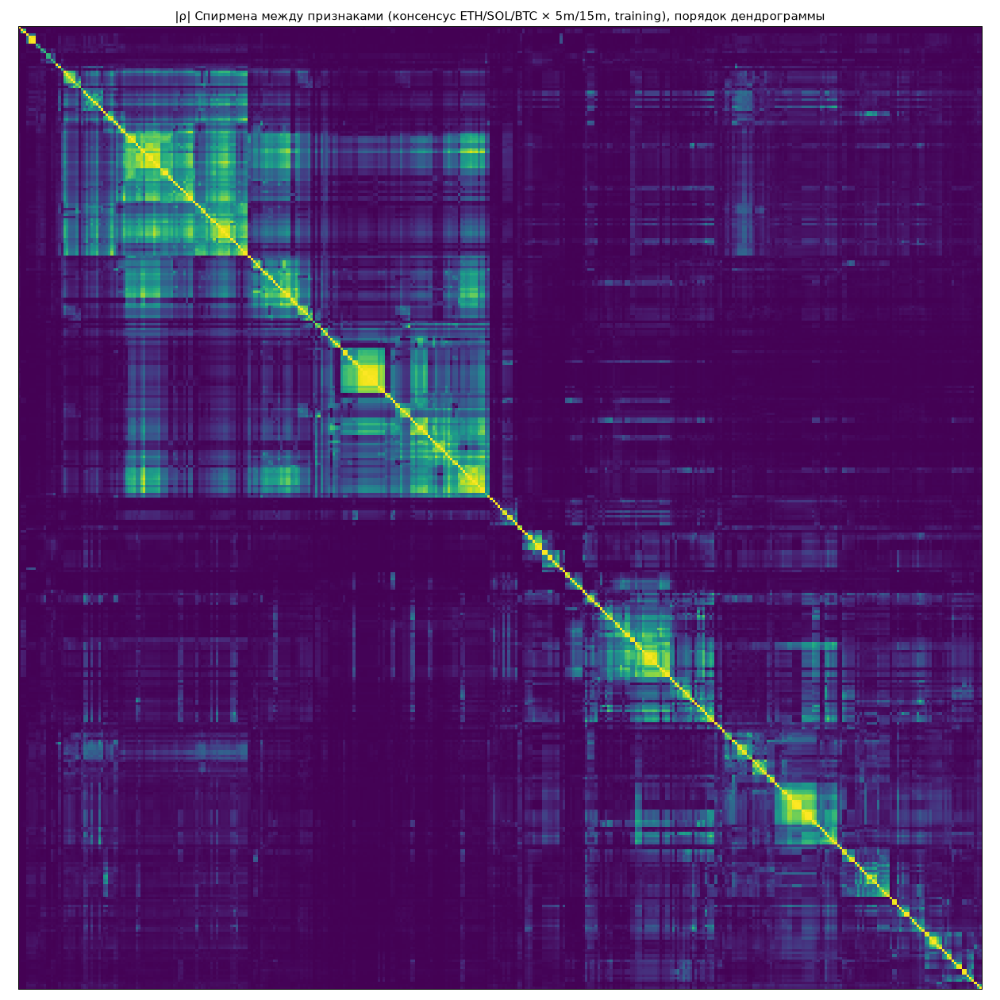

# Feature Factory: корреляции, дубли, кластеры

Данные: training 2020-01-01 — 2024-01-01, 6 пар монета × ТФ, до 60000 баров на пару (первый месяц пропущен — прогрев окон). Validation и holdout не использовались.

## Итог

| Признаков в каталоге | Вырожденных | Дублей (|ρ| ≥ 0.95) | Ядро (уникальные) | Кластеров (|ρ| ≥ 0.7) | Из них одиночек |
|---|---|---|---|---|---|
| 387 | 1 | 47 | 339 | 207 | 132 |

Ядро — `core_features.json`: признаки, из которых собираются гипотезы. Удалённые дубли можно использовать, но они не несут новой информации.

## Вырожденные признаки

`mi_data_gap_minutes`

Вырожденные в отдельных парах (например, контекст монеты для самой себя — NaN по определению):

- ETHUSDT 5m: 18
- ETHUSDT 15m: 18
- SOLUSDT 5m: 18
- SOLUSDT 15m: 17
- BTCUSDT 5m: 18
- BTCUSDT 15m: 18

## Дубли: что удалено и чем заменяется

| Удалён | Оставлен вместо него | |ρ| |
|---|---|---|
| `cg_body_atr` | `cg_body_range` | 0.961 |
| `of_taker_z_288` | `of_taker_share` | 0.972 |
| `mi_trade_size_z` | `lq_trade_size_rel` | 0.984 |
| `st_autocorr1_24` | `lq_roll_spread_24` | 0.954 |
| `st_autocorr1_288` | `rg_variance_ratio_2` | 0.994 |
| `zs_ret_288` | `zs_ret_96` | 0.986 |
| `zs_trades_288` | `lq_trades_rel` | 0.975 |
| `cl_days_to_month_end` | `cl_day_of_month` | 0.996 |
| `cl_week_of_month` | `cl_day_of_month` | 0.976 |
| `ss_code` | `tm_min_since_utc_midnight` | 0.965 |
| `ss_day_range` | `au_value_width` | 0.950 |
| `ss_day_ret` | `gp_prev_day_close_dist` | 0.999 |
| `ss_min_since_asia_open` | `tm_min_since_utc_midnight` | 0.986 |
| `ss_min_since_london_open` | `tm_min_since_london_open` | 1.000 |
| `ss_min_since_ny_open` | `tm_min_since_ny_open` | 1.000 |
| `mr_dist_ema_200` | `mr_z_sma_288` | 0.953 |
| `mr_rsi_6` | `mr_dist_ema_12` | 0.990 |
| `mr_rsi_48` | `mr_z_sma_96` | 0.951 |
| `mr_stoch_96` | `ps_pos_range_96` | 1.000 |
| `mo_ret_1` | `zs_ret_96` | 0.985 |
| `mo_ret_3` | `cg_body3_atr` | 1.000 |
| `mo_ret_24` | `rl_drift_24` | 0.994 |
| `mo_ret_96` | `rl_drift_96` | 0.989 |
| `mo_ret_288` | `rl_drift_288` | 0.981 |
| `mo_consistency_24` | `en_sign_24` | 0.982 |
| `mo_consistency_96` | `en_sign_96` | 0.964 |
| `vl_parkinson_24` | `vl_rv_24` | 0.973 |
| `vl_parkinson_96` | `vl_rv_96` | 0.986 |
| `vl_parkinson_288` | `vl_rv_288` | 0.990 |
| `vl_garman_klass_24` | `vl_rv_24` | 0.952 |
| `vl_garman_klass_288` | `vl_rv_288` | 0.982 |
| `vl_rogers_satchell_288` | `vl_rv_288` | 0.974 |
| `vl_jump_share_288` | `st_kurt_288` | 0.955 |
| `vo_rel_288` | `lq_trades_rel` | 0.965 |
| `vo_z_24` | `vo_rel_24` | 0.970 |
| `vw_roll_dist_24` | `ps_pos_range_24` | 0.962 |
| `vw_roll_dist_96` | `ps_pos_range_96` | 0.960 |
| `vw_roll_dist_288` | `ps_pos_range_288` | 0.952 |
| `rg_efficiency_pctl` | `rg_efficiency_288` | 0.993 |
| `pc_ret_96` | `zs_ret_96` | 0.991 |
| `pc_ret_288` | `zs_ret_96` | 0.982 |
| `pc_ret_8640` | `zs_ret_96` | 0.966 |
| `pc_range_288` | `zs_range_288` | 0.989 |
| `pc_volume_288` | `vo_z_288` | 0.993 |
| `pc_close_96` | `mr_z_sma_96` | 0.983 |
| `pc_close_288` | `mr_z_sma_288` | 0.982 |
| `mr_cci_20` | `mr_z_sma_24` | 0.964 |

## Кластеры: какие признаки описывают одно и то же (|ρ| ≥ 0.7 в среднем)

Кластеров из нескольких признаков: 75; из них смешивают разные категории: 55 — это места, где разные «идеи» на деле измеряют одно и то же.

| # | Размер | Средний |ρ| | Представитель | Категории | Состав |
|---|---|---|---|---|---|
| 33 | 14 | 0.803 | `mr_z_sma_96` | Mean Reversion (5), VWAP (4), Price Structure (3), Percentiles (1), Session (1) | mr_dist_ema_48, mr_rsi_14, mr_rsi_48, mr_stoch_96, mr_z_sma_96, pc_close_96, ps_dist_high_96, ps_dist_low_96, ps_pos_range_96, ss_day_pos, vw_day_band_z, vw_day_dist, vw_day_slope_6, vw_roll_dist_96 |
| 159 | 14 | 0.801 | `vl_parkinson_96` | Volatility (12), BTC Context (1), ETH Context (1) | cx_btc_rv_96, cx_eth_rv_96, vl_garman_klass_24, vl_garman_klass_288, vl_parkinson_24, vl_parkinson_288, vl_parkinson_6, vl_parkinson_96, vl_rogers_satchell_24, vl_rogers_satchell_288, vl_rv_24, vl_rv_288, vl_rv_6, vl_rv_96 |
| 74 | 13 | 0.855 | `mo_ret_1` | Candle Geometry (4), Percentiles (3), Sequence (2), Z-Score (2), Cluster Features (1), Momentum (1) | cf_bar_shape, cg_body_atr, cg_body_range, cg_clv, cg_dir, mo_ret_1, pc_ret_288, pc_ret_8640, pc_ret_96, sq_down_streak, sq_up_streak, zs_ret_288, zs_ret_96 |
| 88 | 11 | 0.839 | `vw_roll_dist_24` | Mean Reversion (5), Price Structure (3), Momentum (2), VWAP (1) | mo_macd_hist, mo_ret_12, mr_cci_20, mr_dist_ema_12, mr_rsi_6, mr_stoch_14, mr_z_sma_24, ps_dist_high_24, ps_dist_low_24, ps_pos_range_24, vw_roll_dist_24 |
| 130 | 11 | 0.812 | `pc_volume_288` | Z-Score (4), Volume (3), Percentiles (2), Candle Geometry (1), Liquidity (1) | cg_range_atr, lq_trades_rel, pc_range_288, pc_volume_288, vo_rel_288, vo_rel_96, vo_z_288, zs_intrabar_rv_288, zs_range_288, zs_range_96, zs_trades_288 |
| 43 | 8 | 0.843 | `mr_z_sma_288` | Auction (2), Mean Reversion (2), Price Structure (2), Percentiles (1), VWAP (1) | au_prev_day_high_dist, au_prev_day_pos, mr_dist_ema_200, mr_z_sma_288, pc_close_288, ps_dist_high_288, ps_pos_range_288, vw_roll_dist_288 |
| 53 | 7 | 0.784 | `cv_slope_48` | Curvature (2), Acceleration (1), Momentum (1), Regime (1), Rolling Statistics (1), Volatility (1) | ac_ret_24, cv_quad_48, cv_slope_48, mo_ret_24, rg_trend_tstat_24, rl_drift_24, vl_semivar_ratio_24 |
| 81 | 7 | 0.783 | `mr_z_sma_6` | Price Structure (3), Candle Geometry (2), Momentum (1), Mean Reversion (1) | cg_body2_atr, cg_body3_atr, mo_ret_3, mr_z_sma_6, ps_dist_high_6, ps_dist_low_6, ps_pos_range_6 |
| 82 | 5 | 0.809 | `cv_slope_12` | Curvature (3), Acceleration (2) | ac_ema_slope_chg, ac_ret_6, cv_ema_second_diff, cv_quad_12, cv_slope_12 |
| 45 | 4 | 0.858 | `rl_drift_288` | Momentum (1), Regime (1), Rolling Statistics (1), Volume (1) | mo_ret_288, rg_trend_tstat_288, rl_drift_288, vo_up_share_288 |
| 103 | 4 | 0.857 | `tm_min_since_utc_midnight` | Session (2), Time (2) | ss_code, ss_min_since_asia_open, tm_hour_sin, tm_min_since_utc_midnight |
| 38 | 4 | 0.852 | `rl_drift_96` | Momentum (1), Regime (1), Rolling Statistics (1), Volume (1) | mo_ret_96, rg_trend_tstat_96, rl_drift_96, vo_up_share_96 |
| 150 | 4 | 0.832 | `cx_eth_corr_288` | BTC Context (2), ETH Context (2) | cx_btc_corr_288, cx_btc_corr_96, cx_eth_corr_288, cx_eth_corr_96 |
| 176 | 4 | 0.829 | `st_kurt_288` | Volatility (2), Rolling Statistics (1), Statistical (1) | rl_median_abs_288, st_kurt_288, vl_jump_share_288, vl_vol_of_vol_288 |
| 15 | 4 | 0.801 | `cx_eth_spread_288` | Relative Strength (2), BTC Context (1), ETH Context (1) | cx_btc_spread_288, cx_eth_spread_288, rs_rank_288, rs_vs_basket_288 |
| 80 | 4 | 0.799 | `cx_eth_spread_6` | Relative Strength (2), BTC Context (1), ETH Context (1) | cx_btc_spread_6, cx_eth_spread_6, rs_rank_6, rs_vs_basket_6 |
| 58 | 4 | 0.799 | `cx_eth_spread_24` | Relative Strength (2), BTC Context (1), ETH Context (1) | cx_btc_spread_24, cx_eth_spread_24, rs_rank_24, rs_vs_basket_24 |
| 161 | 4 | 0.764 | `vl_atr_pctl_30d` | Volatility (3), Regime (1) | rg_vol, vl_atr_pctl_30d, vl_atr_pctl_7d, vl_atr_pctl_90d |
| 3 | 3 | 0.981 | `cl_day_of_month` | Calendar (3) | cl_day_of_month, cl_days_to_month_end, cl_week_of_month |
| 192 | 3 | 0.945 | `st_autocorr1_288` | Liquidity (1), Regime (1), Statistical (1) | lq_roll_spread_288, rg_variance_ratio_2, st_autocorr1_288 |
| 34 | 3 | 0.913 | `ss_day_ret` | Auction (1), Gap (1), Session (1) | au_initial_balance_state, gp_prev_day_close_dist, ss_day_ret |
| 140 | 3 | 0.851 | `ex_atr_ratio_14_100` | Expansion (1), Volatility (1), Volume (1) | ex_atr_ratio_14_100, vl_ratio_24_288, vo_trend |
| 135 | 3 | 0.831 | `fr_scaling_6_24` | Fractal (2), Price Structure (1) | fr_katz_24, fr_scaling_6_24, ps_range_24 |
| 117 | 3 | 0.830 | `lq_depth_proxy_24` | Liquidity (3) | lq_depth_proxy_24, lq_depth_proxy_6, lq_depth_proxy_96 |
| 126 | 3 | 0.824 | `vo_z_24` | Volume (3) | vo_rel_24, vo_rel_6, vo_z_24 |
| 129 | 3 | 0.816 | `pc_volume_8640` | Percentiles (2), Volume (1) | pc_range_8640, pc_volume_8640, vo_time_of_day_rel |
| 182 | 3 | 0.800 | `rg_efficiency_288` | Regime (2), Fractal (1) | fr_scaling_24_288, rg_efficiency_288, rg_efficiency_pctl |
| 153 | 3 | 0.798 | `cx_eth_beta_96` | ETH Context (3) | cx_eth_beta_288, cx_eth_beta_96, cx_eth_vol_ratio |
| 154 | 3 | 0.796 | `cx_btc_beta_96` | BTC Context (3) | cx_btc_beta_288, cx_btc_beta_96, cx_btc_vol_ratio |
| 178 | 3 | 0.796 | `vl_vol_of_vol_96` | Rolling Statistics (1), Statistical (1), Volatility (1) | rl_median_abs_96, st_kurt_96, vl_vol_of_vol_96 |
| 50 | 3 | 0.765 | `st_skew_24` | Rolling Statistics (2), Statistical (1) | rl_max_r_24, rl_min_r_24, st_skew_24 |
| 122 | 3 | 0.736 | `ps_range_6` | Compression (1), Expansion (1), Price Structure (1) | cp_range_ratio_6, ex_atr_change_6, ps_range_6 |
| 107 | 2 | 1.000 | `ss_min_since_london_open` | Session (1), Time (1) | ss_min_since_london_open, tm_min_since_london_open |
| 106 | 2 | 1.000 | `ss_min_since_ny_open` | Session (1), Time (1) | ss_min_since_ny_open, tm_min_since_ny_open |
| 128 | 2 | 0.984 | `mi_trade_size_z` | Liquidity (1), Microstructure Proxy (1) | lq_trade_size_rel, mi_trade_size_z |
| 200 | 2 | 0.982 | `mo_consistency_24` | Entropy (1), Momentum (1) | en_sign_24, mo_consistency_24 |
| 72 | 2 | 0.972 | `of_taker_share` | Order Flow Proxy (2) | of_taker_share, of_taker_z_288 |
| 181 | 2 | 0.964 | `en_sign_96` | Entropy (1), Momentum (1) | en_sign_96, mo_consistency_96 |
| 197 | 2 | 0.954 | `st_autocorr1_24` | Liquidity (1), Statistical (1) | lq_roll_spread_24, st_autocorr1_24 |
| 102 | 2 | 0.950 | `au_value_width` | Auction (1), Session (1) | au_value_width, ss_day_range |
| 191 | 2 | 0.941 | `st_autocorr1_96` | Liquidity (1), Statistical (1) | lq_roll_spread_96, st_autocorr1_96 |
| 170 | 2 | 0.921 | `st_kurt_24` | Statistical (1), Volatility (1) | st_kurt_24, vl_jump_share_24 |
| 27 | 2 | 0.895 | `st_skew_288` | Statistical (1), Volatility (1) | st_skew_288, vl_semivar_ratio_288 |
| 155 | 2 | 0.891 | `lq_amihud_24` | Liquidity (2) | lq_amihud_24, lq_amihud_288 |
| 94 | 2 | 0.889 | `cg_lower_atr` | Candle Geometry (2) | cg_lower_atr, cg_lower_range |
| 169 | 2 | 0.887 | `vo_concentration_24` | Entropy (1), Volume (1) | en_volume_24, vo_concentration_24 |
| 95 | 2 | 0.886 | `cg_upper_atr` | Candle Geometry (2) | cg_upper_atr, cg_upper_range |
| 31 | 2 | 0.871 | `st_skew_96` | Statistical (1), Volatility (1) | st_skew_96, vl_semivar_ratio_96 |
| 194 | 2 | 0.860 | `st_sign_changes_96` | Entropy (1), Statistical (1) | en_permutation_96, st_sign_changes_96 |
| 193 | 2 | 0.855 | `rg_variance_ratio_4` | Regime (2) | rg_variance_ratio_4, rg_variance_ratio_8 |
| 73 | 2 | 0.839 | `cx_eth_ret_1` | BTC Context (1), ETH Context (1) | cx_btc_ret_1, cx_eth_ret_1 |
| 87 | 2 | 0.835 | `cx_btc_ret_6` | BTC Context (1), ETH Context (1) | cx_btc_ret_6, cx_eth_ret_6 |
| 52 | 2 | 0.829 | `cx_btc_ret_24` | BTC Context (1), ETH Context (1) | cx_btc_ret_24, cx_eth_ret_24 |
| 79 | 2 | 0.827 | `cx_btc_resid_3` | BTC Context (1), ETH Context (1) | cx_btc_resid_3, cx_eth_resid_3 |
| 41 | 2 | 0.824 | `cx_btc_ret_288` | BTC Context (1), ETH Context (1) | cx_btc_ret_288, cx_eth_ret_288 |
| 112 | 2 | 0.823 | `cg_outside` | Candle Geometry (2) | cg_engulf, cg_outside |
| 51 | 2 | 0.812 | `mo_up_frac_24` | Momentum (1), Volume (1) | mo_up_frac_24, vo_up_share_24 |
| 101 | 2 | 0.807 | `tm_us_dst` | Calendar (1), Time (1) | cl_month_cos, tm_us_dst |
| 35 | 2 | 0.797 | `vw_day_slope_24` | VWAP (2) | vw_above_frac_24, vw_day_slope_24 |
| 125 | 2 | 0.794 | `cx_eth_vol_rel` | BTC Context (1), ETH Context (1) | cx_btc_vol_rel, cx_eth_vol_rel |
| 21 | 2 | 0.792 | `gp_week_open_dist` | Gap (1), VWAP (1) | gp_week_open_dist, vw_week_dist |
| 108 | 2 | 0.791 | `tm_dow_sin` | Time (2) | tm_dow_sin, tm_weekend |
| 138 | 2 | 0.784 | `ex_atr_change_24` | Expansion (2) | ex_atr_change_24, ex_atr_ratio_5_50 |
| 68 | 2 | 0.781 | `cg_body_atr_lag2` | Candle Geometry (2) | cg_body_atr_lag2, cg_clv_lag2 |
| 134 | 2 | 0.779 | `of_effort_result_24` | Order Flow Proxy (1), Regime (1) | of_effort_result_24, rg_efficiency_24 |
| 76 | 2 | 0.778 | `cg_body_atr_lag1` | Candle Geometry (2) | cg_body_atr_lag1, cg_clv_lag1 |
| 83 | 2 | 0.777 | `ps_hh_minus_ll_6` | Momentum (1), Price Structure (1) | mo_ret_6, ps_hh_minus_ll_6 |
| 44 | 2 | 0.757 | `ps_dist_low_288` | Auction (1), Price Structure (1) | au_prev_day_low_dist, ps_dist_low_288 |
| 115 | 2 | 0.725 | `cp_narrowest_4` | Compression (2) | cp_narrowest_4, cp_narrowest_7 |
| 42 | 2 | 0.722 | `mo_tsmom_1d` | Momentum (1), Regime (1) | mo_tsmom_1d, rg_btc |
| 146 | 2 | 0.721 | `cx_sol_beta_96` | SOL Context (2) | cx_sol_beta_96, cx_sol_vol_ratio |
| 137 | 2 | 0.718 | `ps_range_96` | Compression (1), Price Structure (1) | cp_range_ratio_24, ps_range_96 |
| 187 | 2 | 0.717 | `fr_katz_96` | Fractal (1), Regime (1) | fr_katz_96, rg_efficiency_96 |
| 30 | 2 | 0.711 | `of_taker_share_288` | Order Flow Proxy (2) | of_taker_share_288, of_taker_share_96 |
| 66 | 2 | 0.705 | `ps_break_state_96` | Price Structure (2) | ps_break_state_288, ps_break_state_96 |
