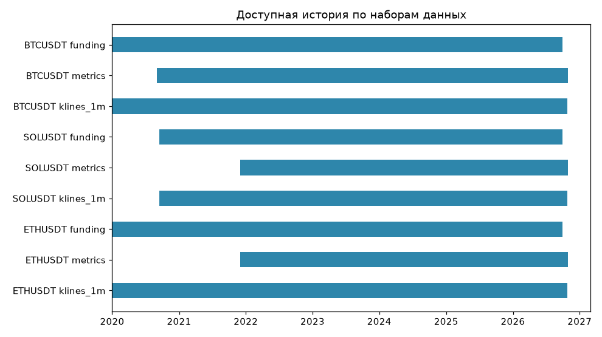
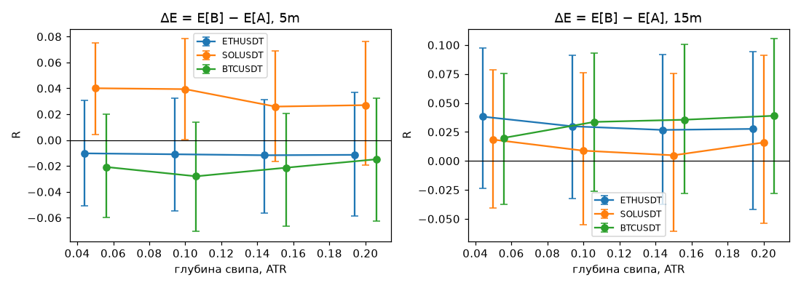
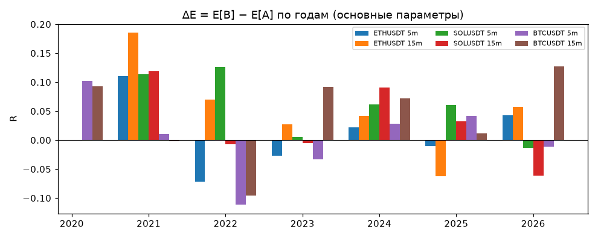
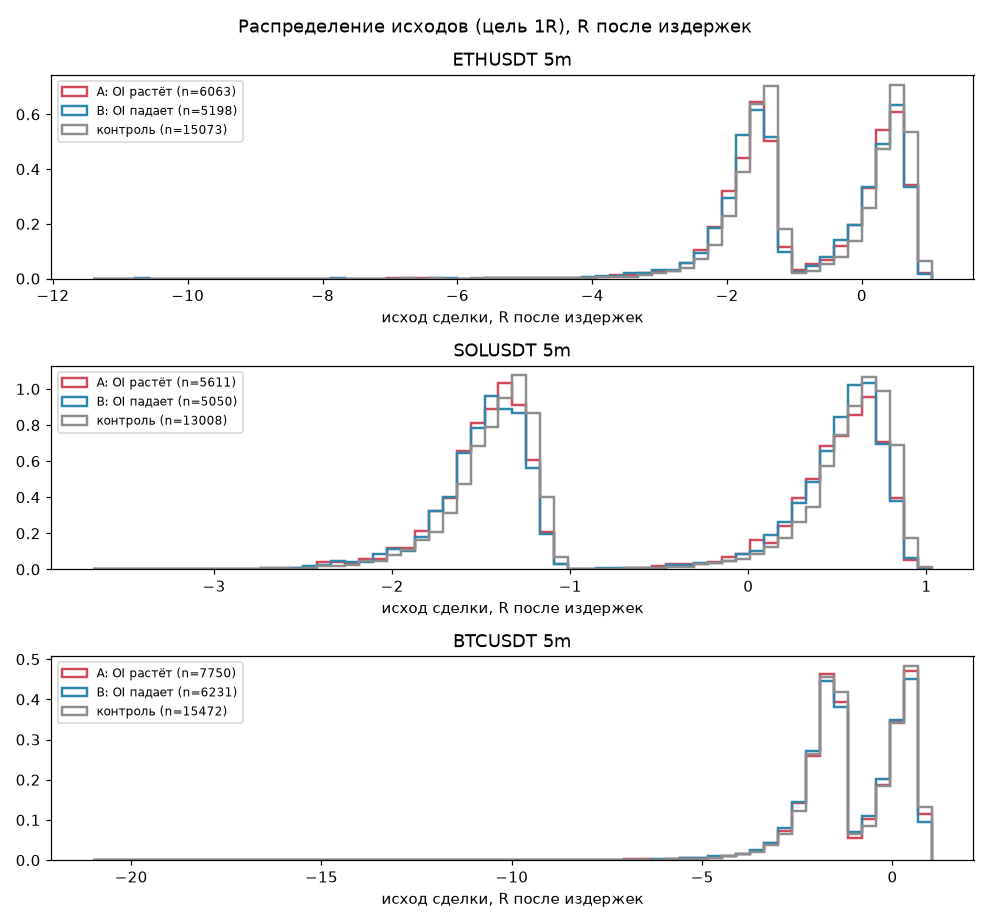
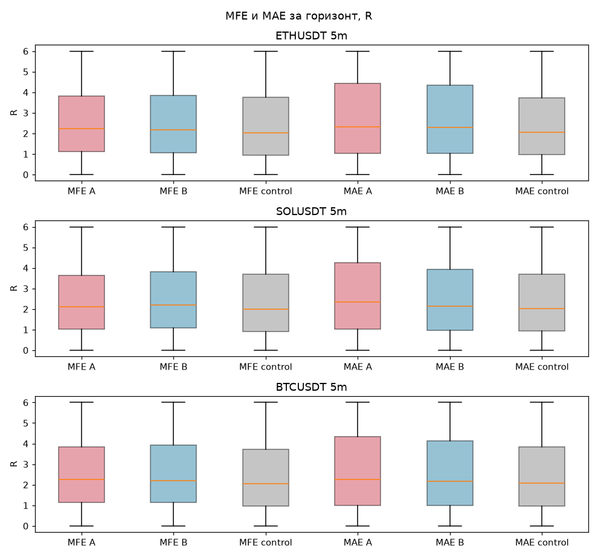
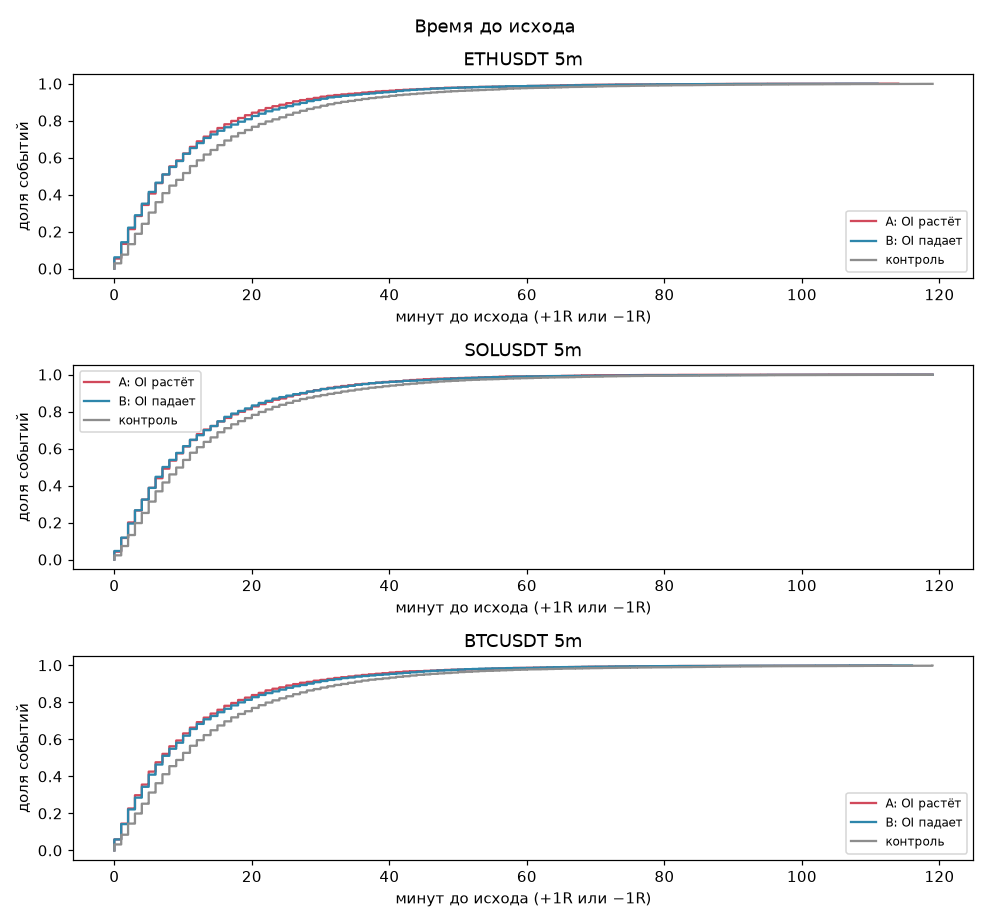
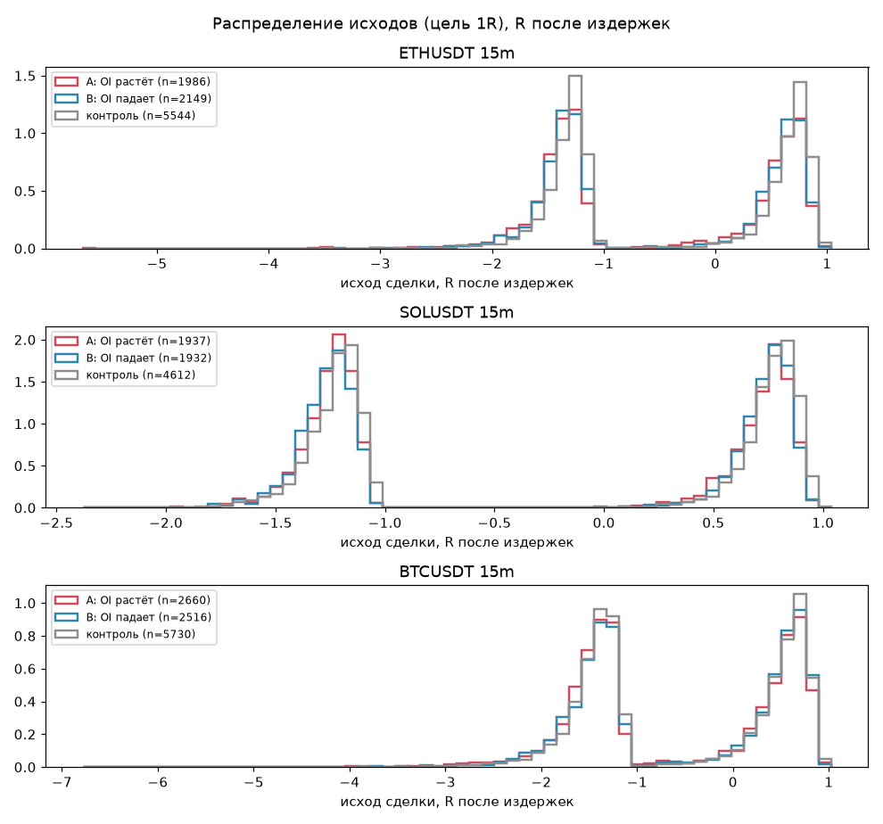
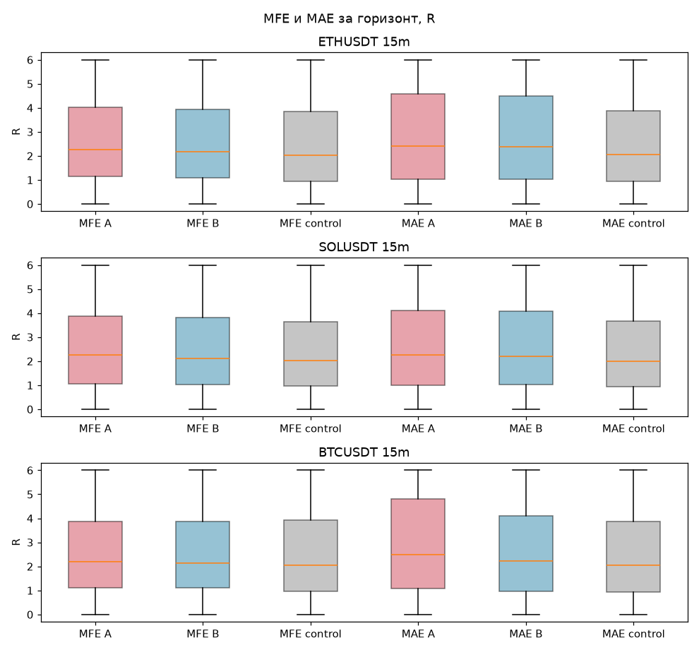
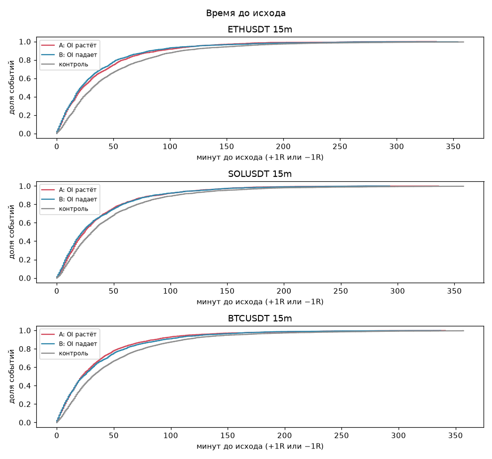

# Отчёт: nif_v1 — свипы с ростом OI против свипов с падением OI

Сформирован автоматически 2026-10-30 08:34 UTC. Конфиг `configs/mvp.toml` (хэш `f3e49343c8cd`), версия сырых данных `c7ee8861e928`, коммит `9bf3969`.

> Расчёт исследовательский, не торговая рекомендация.

## 1. Гипотеза и правило вердикта (зафиксированы до запуска)

Главная гипотеза этапа 1 (NIF): разворот после свипа определяется характером потока. **Группа A** — OI к моменту решения вырос (новые позиции) → ожидается продолжение. **Группа B** — OI упал (закрытия, стопы, ликвидации) → ожидается разворот. В обеих группах одна и та же сделка — реверсия против свипа. Проверяется **ΔE = E[B] − E[A] > 0**.

- Основная метрика: исход «цель 1R / стоп 1R / выход через 24 баров», в R после издержек (0.14% за круг).
- «Подтверждено» для пары монета×ТФ: ΔE ≥ 0.05R, нижняя граница 95% CI(ΔE) > 0, p после поправки Бенджамини–Хохберга < 0.05.
- Гипотеза поддержана в целом, если подтверждена на ETH **и** SOL на одном ТФ при основных параметрах и минимум в 3 из 4 значений глубины свипа.

## 2. Итог

Главная гипотеза по пререгистрированному правилу: **НЕ ПОДДЕРЖАНА**.

| Монета | ТФ | Вердикт (основные параметры) | Подтверждено по глубинам |
|---|---|---|---|
| ETHUSDT | 5m | не подтверждено | 0 из 4 |
| SOLUSDT | 5m | не подтверждено | 0 из 4 |
| BTCUSDT | 5m | не подтверждено | 0 из 4 |
| ETHUSDT | 15m | не подтверждено | 0 из 4 |
| SOLUSDT | 15m | не подтверждено | 0 из 4 |
| BTCUSDT | 15m | не подтверждено | 0 из 4 |

Торгуемость самой реверсии в группе B (отдельно от разницы групп):

| Монета | ТФ | E[B], R | 95% CI | CI > 0 |
|---|---|---|---|---|
| ETHUSDT | 5m | -0.814 | [-0.854; -0.778] | нет |
| ETHUSDT | 15m | -0.445 | [-0.492; -0.400] | нет |
| SOLUSDT | 5m | -0.493 | [-0.524; -0.461] | нет |
| SOLUSDT | 15m | -0.287 | [-0.333; -0.240] | нет |
| BTCUSDT | 5m | -1.030 | [-1.072; -0.988] | нет |
| BTCUSDT | 15m | -0.524 | [-0.568; -0.483] | нет |

## 3. Данные

Источник — публичный архив Binance USDⓈ-M futures. Задержка публикации OI: 5 мин после метки снимка; OI старше 30 мин считается неизвестным.

| Монета | Набор | Начало | Конец | Строк | Покрытие % | Пропущено | Дублей | Аномалии | Вердикт |
|---|---|---|---|---|---|---|---|---|---|
| ETHUSDT | klines_1m | 2020-01-01 00:00:00+00:00 | 2026-10-27 23:59:00+00:00 | 3588480 | 100.00 | 0 | 0 | zero_volume_bars=302, abs_1m_return_gt_10pct=3 | ГОДНО |
| ETHUSDT | metrics | 2021-12-01 00:00:00+00:00 | 2026-10-29 23:55:00+00:00 | 516532 | 99.97 | 140 | 0 | oi_nonpositive_or_nan=215, oi_5m_jump_gt_20pct=149 | ГОДНО |
| ETHUSDT | funding | 2020-01-01 00:00:00+00:00 | 2026-09-30 16:00:00.002000+00:00 | 7395 | — | — | 0 | interval_8h=7394 | ГОДНО |
| SOLUSDT | klines_1m | 2020-09-14 07:00:00+00:00 | 2026-10-27 23:59:00+00:00 | 3210780 | 99.78 | 7200 | 0 | zero_volume_bars=473, abs_1m_return_gt_10pct=10 | ГОДНО |
| SOLUSDT | metrics | 2021-12-01 00:00:00+00:00 | 2026-10-29 23:55:00+00:00 | 516515 | 99.97 | 157 | 0 | oi_nonpositive_or_nan=201, oi_5m_jump_gt_20pct=120 | ГОДНО |
| SOLUSDT | funding | 2020-09-13 16:00:00.004000+00:00 | 2026-09-30 16:00:00.002000+00:00 | 6700 | — | — | 0 | funding_abs_gt_1pct=11, interval_8h=6598, interval_2h=98, interval_4h=3 | ОСТОРОЖНО: аномалий > 0.1% строк |
| BTCUSDT | klines_1m | 2020-01-01 00:00:00+00:00 | 2026-10-27 23:59:00+00:00 | 3588480 | 100.00 | 0 | 0 | zero_volume_bars=369 | ГОДНО |
| BTCUSDT | metrics | 2020-09-01 00:00:00+00:00 | 2026-10-29 23:55:00+00:00 | 647366 | 99.90 | 634 | 75255 | oi_nonpositive_or_nan=481, oi_5m_jump_gt_20pct=542 | ОСТОРОЖНО: аномалий > 0.1% строк |
| BTCUSDT | funding | 2020-01-01 00:00:00+00:00 | 2026-09-30 16:00:00.002000+00:00 | 7395 | — | — | 0 | interval_8h=7394 | ГОДНО |

Крупнейшие разрывы:

| Монета | Набор | Начало разрыва | Длительность |
|---|---|---|---|
| ETHUSDT | metrics | 2024-02-16 13:30:00+00:00 | 0 days 10:30:00 |
| ETHUSDT | metrics | 2023-09-12 08:35:00+00:00 | 0 days 00:20:00 |
| ETHUSDT | metrics | 2025-08-29 06:15:00+00:00 | 0 days 00:20:00 |
| SOLUSDT | klines_1m | 2022-02-25 23:59:00+00:00 | 3 days 00:01:00 |
| SOLUSDT | klines_1m | 2022-03-31 23:59:00+00:00 | 2 days 00:01:00 |
| SOLUSDT | metrics | 2024-02-16 13:30:00+00:00 | 0 days 10:30:00 |
| SOLUSDT | metrics | 2023-12-12 23:15:00+00:00 | 0 days 00:45:00 |
| SOLUSDT | metrics | 2023-12-08 23:20:00+00:00 | 0 days 00:40:00 |
| BTCUSDT | metrics | 2024-02-16 13:30:00+00:00 | 0 days 10:30:00 |
| BTCUSDT | metrics | 2021-02-19 20:00:00+00:00 | 0 days 05:20:00 |
| BTCUSDT | metrics | 2021-06-22 18:25:00+00:00 | 0 days 04:25:00 |

## 4. Методика

- **Свип**: уровень — экстремум предыдущих 24 баров, не моложе 3 баров; вынос за уровень ≥ depth·ATR предыдущего бара (основное depth = 0.1); закрытие обратно за уровень; не чаще одного события стороны за 12 баров. Только прошлые данные.
- **OI**: ΔOI за 3 бара по значениям, опубликованным до закрытия бара свипа.
- **Вход**: открытие минуты сразу после закрытия бара свипа. 1R = 1.0·ATR. Путь — 1m-свечи; если цель и стоп в одной минуте — засчитывается стоп.
- **Контроль**: на каждое событие — случайный бар без свипа с тем же часом UTC и той же децилью процентиля ATR, та же сделка.
- **Статистика**: блочный бутстреп по дням (2000 повторов) для 95% CI; выбор основного теста по нормальности (перестановочный, 5000 перестановок, или Уэлч); Манн–Уитни и Колмогоров–Смирнов для распределений; χ²/Фишер для win rate; Cliff's delta и Cohen's d; поправка BH внутри семейства торгуемых прогонов.

## 5. Результаты по рынкам (основные параметры)

### ETHUSDT 5m

| Счётчик | Число |
|---|---|
| sweeps_total | 15116 |
| excluded: OI неизвестен (нет данных или устарел) | 3855 |
| excluded: OI не изменился (ровно 0) | 0 |
| group_A_oi_up | 6063 |
| group_B_oi_down | 5198 |
| control | 15073 |

| Группа | N | Дней | Win rate | Expectancy R | 95% CI | Медиана | PF | MFE ср. | MAE ср. |
|---|---|---|---|---|---|---|---|---|---|
| A: OI растёт | 6063 | 1741 | 0.382 | -0.803 | [-0.837; -0.769] | -1.231 | 0.167 | 2.959 | 3.466 |
| B: OI падает | 5198 | 1703 | 0.375 | -0.814 | [-0.854; -0.778] | -1.259 | 0.163 | 3.005 | 3.404 |
| все свипы (A+B) | 11261 | 1791 | 0.379 | -0.808 | [-0.837; -0.780] | -1.245 | 0.165 | 2.980 | 3.437 |
| контроль | 15073 | 2480 | 0.422 | -0.682 | [-0.706; -0.657] | -1.169 | 0.229 | 2.888 | 2.904 |

**B против A**: ΔE = -0.0110 R, 95% CI [-0.0546; 0.0322]; Δ win rate = -0.008; основной тест — permutation (разница средних) (нормальность отвергнута (D'Agostino–Pearson) → перестановочный тест без допущений о форме): p = 0.6043, после BH = 0.7228; Манн–Уитни p = 0.5756; KS p = 0.6925; Welch p = 0.6089; win rate p = 0.4226; Cliff's δ = -0.006 (пренебрежимый); Cohen's d = -0.010.

**все свипы против контроля**: ΔE = -0.1265 R, 95% CI [-0.1565; -0.0974]; Δ win rate = -0.043; основной тест — permutation (разница средних) (нормальность отвергнута (D'Agostino–Pearson) → перестановочный тест без допущений о форме): p = 0.0002; Манн–Уитни p = <0.0001; KS p = <0.0001; Welch p = <0.0001; win rate p = <0.0001; Cliff's δ = -0.096 (пренебрежимый); Cohen's d = -0.112.

Вердикт: **не подтверждено**.

### ETHUSDT 15m

| Счётчик | Число |
|---|---|
| sweeps_total | 5557 |
| excluded: нет минутных данных на входе или за горизонтом | 1 |
| excluded: OI неизвестен (нет данных или устарел) | 1421 |
| excluded: OI не изменился (ровно 0) | 0 |
| group_A_oi_up | 1986 |
| group_B_oi_down | 2149 |
| control | 5544 |

| Группа | N | Дней | Win rate | Expectancy R | 95% CI | Медиана | PF | MFE ср. | MAE ср. |
|---|---|---|---|---|---|---|---|---|---|
| A: OI растёт | 1986 | 1290 | 0.456 | -0.475 | [-0.520; -0.426] | -1.159 | 0.369 | 3.151 | 3.543 |
| B: OI падает | 2149 | 1320 | 0.470 | -0.445 | [-0.492; -0.400] | -1.132 | 0.393 | 3.059 | 3.380 |
| все свипы (A+B) | 4135 | 1703 | 0.463 | -0.459 | [-0.493; -0.427] | -1.144 | 0.382 | 3.103 | 3.459 |
| контроль | 5544 | 2214 | 0.491 | -0.348 | [-0.378; -0.320] | -0.560 | 0.485 | 2.929 | 2.928 |

**B против A**: ΔE = 0.0298 R, 95% CI [-0.0324; 0.0910]; Δ win rate = 0.013; основной тест — permutation (разница средних) (нормальность отвергнута (D'Agostino–Pearson) → перестановочный тест без допущений о форме): p = 0.3649, после BH = 0.7228; Манн–Уитни p = 0.2018; KS p = 0.5150; Welch p = 0.3545; win rate p = 0.4080; Cliff's δ = 0.023 (пренебрежимый); Cohen's d = 0.029.

**все свипы против контроля**: ΔE = -0.1111 R, 95% CI [-0.1527; -0.0720]; Δ win rate = -0.028; основной тест — permutation (разница средних) (нормальность отвергнута (D'Agostino–Pearson) → перестановочный тест без допущений о форме): p = 0.0002; Манн–Уитни p = <0.0001; KS p = <0.0001; Welch p = <0.0001; win rate p = 0.0071; Cliff's δ = -0.126 (пренебрежимый); Cohen's d = -0.108.

Вердикт: **не подтверждено**.

### SOLUSDT 5m

| Счётчик | Число |
|---|---|
| sweeps_total | 13047 |
| excluded: OI неизвестен (нет данных или устарел) | 2384 |
| excluded: OI не изменился (ровно 0) | 2 |
| group_A_oi_up | 5611 |
| group_B_oi_down | 5050 |
| control | 13008 |

| Группа | N | Дней | Win rate | Expectancy R | 95% CI | Медиана | PF | MFE ср. | MAE ср. |
|---|---|---|---|---|---|---|---|---|---|
| A: OI растёт | 5611 | 1715 | 0.459 | -0.532 | [-0.559; -0.505] | -1.164 | 0.315 | 2.762 | 3.223 |
| B: OI падает | 5050 | 1687 | 0.481 | -0.493 | [-0.524; -0.461] | -0.571 | 0.345 | 2.878 | 2.948 |
| все свипы (A+B) | 10661 | 1784 | 0.469 | -0.513 | [-0.535; -0.491] | -1.136 | 0.329 | 2.817 | 3.093 |
| контроль | 13008 | 2218 | 0.483 | -0.437 | [-0.456; -0.416] | -0.753 | 0.396 | 2.759 | 2.748 |

**B против A**: ΔE = 0.0394 R, 95% CI [0.0004; 0.0784]; Δ win rate = 0.022; основной тест — permutation (разница средних) (нормальность отвергнута (D'Agostino–Pearson) → перестановочный тест без допущений о форме): p = 0.0514, после BH = 0.6167; Манн–Уитни p = 0.0837; KS p = 0.0141; Welch p = 0.0493; win rate p = 0.0263; Cliff's δ = 0.019 (пренебрежимый); Cohen's d = 0.038.

**все свипы против контроля**: ΔE = -0.0768 R, 95% CI [-0.1047; -0.0502]; Δ win rate = -0.013; основной тест — permutation (разница средних) (нормальность отвергнута (D'Agostino–Pearson) → перестановочный тест без допущений о форме): p = 0.0002; Манн–Уитни p = <0.0001; KS p = <0.0001; Welch p = <0.0001; win rate p = 0.0401; Cliff's δ = -0.089 (пренебрежимый); Cohen's d = -0.074.

Вердикт: **не подтверждено**.

### SOLUSDT 15m

| Счётчик | Число |
|---|---|
| sweeps_total | 4623 |
| excluded: нет минутных данных на входе или за горизонтом | 1 |
| excluded: OI неизвестен (нет данных или устарел) | 753 |
| excluded: OI не изменился (ровно 0) | 0 |
| group_A_oi_up | 1937 |
| group_B_oi_down | 1932 |
| control | 4612 |

| Группа | N | Дней | Win rate | Expectancy R | 95% CI | Медиана | PF | MFE ср. | MAE ср. |
|---|---|---|---|---|---|---|---|---|---|
| A: OI растёт | 1937 | 1247 | 0.487 | -0.296 | [-0.342; -0.251] | -1.089 | 0.543 | 2.793 | 3.088 |
| B: OI падает | 1932 | 1242 | 0.491 | -0.287 | [-0.333; -0.240] | -1.084 | 0.556 | 2.880 | 2.993 |
| все свипы (A+B) | 3869 | 1669 | 0.489 | -0.291 | [-0.323; -0.261] | -1.086 | 0.550 | 2.837 | 3.041 |
| контроль | 4612 | 1924 | 0.507 | -0.223 | [-0.253; -0.191] | 0.350 | 0.635 | 2.750 | 2.736 |

**B против A**: ΔE = 0.0088 R, 95% CI [-0.0548; 0.0759]; Δ win rate = 0.004; основной тест — permutation (разница средних) (нормальность отвергнута (D'Agostino–Pearson) → перестановочный тест без допущений о форме): p = 0.7910, после BH = 0.8254; Манн–Уитни p = 0.9081; KS p = 0.4426; Welch p = 0.7855; win rate p = 0.8358; Cliff's δ = -0.002 (пренебрежимый); Cohen's d = 0.009.

**все свипы против контроля**: ΔE = -0.0685 R, 95% CI [-0.1109; -0.0259]; Δ win rate = -0.018; основной тест — permutation (разница средних) (нормальность отвергнута (D'Agostino–Pearson) → перестановочный тест без допущений о форме): p = 0.0018; Манн–Уитни p = <0.0001; KS p = <0.0001; Welch p = 0.0018; win rate p = 0.1099; Cliff's δ = -0.106 (пренебрежимый); Cohen's d = -0.068.

Вердикт: **не подтверждено**.

### BTCUSDT 5m

| Счётчик | Число |
|---|---|
| sweeps_total | 15516 |
| excluded: OI неизвестен (нет данных или устарел) | 1524 |
| excluded: OI не изменился (ровно 0) | 11 |
| group_A_oi_up | 7750 |
| group_B_oi_down | 6231 |
| control | 15472 |

| Группа | N | Дней | Win rate | Expectancy R | 95% CI | Медиана | PF | MFE ср. | MAE ср. |
|---|---|---|---|---|---|---|---|---|---|
| A: OI растёт | 7750 | 2199 | 0.323 | -1.002 | [-1.039; -0.963] | -1.320 | 0.115 | 3.016 | 3.369 |
| B: OI падает | 6231 | 2114 | 0.304 | -1.030 | [-1.072; -0.988] | -1.312 | 0.105 | 2.996 | 3.250 |
| все свипы (A+B) | 13981 | 2247 | 0.314 | -1.014 | [-1.047; -0.982] | -1.317 | 0.110 | 3.007 | 3.316 |
| контроль | 15472 | 2482 | 0.331 | -0.973 | [-1.007; -0.939] | -1.286 | 0.123 | 2.924 | 2.945 |

**B против A**: ΔE = -0.0280 R, 95% CI [-0.0706; 0.0138]; Δ win rate = -0.018; основной тест — permutation (разница средних) (нормальность отвергнута (D'Agostino–Pearson) → перестановочный тест без допущений о форме): p = 0.1968, после BH = 0.6836; Манн–Уитни p = 0.1180; KS p = 0.0632; Welch p = 0.1989; win rate p = 0.0216; Cliff's δ = -0.015 (пренебрежимый); Cohen's d = -0.022.

**все свипы против контроля**: ΔE = -0.0411 R, 95% CI [-0.0693; -0.0119]; Δ win rate = -0.016; основной тест — permutation (разница средних) (нормальность отвергнута (D'Agostino–Pearson) → перестановочный тест без допущений о форме): p = 0.0058; Манн–Уитни p = 0.0001; KS p = 0.0046; Welch p = 0.0065; win rate p = 0.0026; Cliff's δ = -0.026 (пренебрежимый); Cohen's d = -0.032.

Вердикт: **не подтверждено**.

### BTCUSDT 15m

| Счётчик | Число |
|---|---|
| sweeps_total | 5751 |
| excluded: OI неизвестен (нет данных или устарел) | 570 |
| excluded: OI не изменился (ровно 0) | 5 |
| group_A_oi_up | 2660 |
| group_B_oi_down | 2516 |
| control | 5730 |

| Группа | N | Дней | Win rate | Expectancy R | 95% CI | Медиана | PF | MFE ср. | MAE ср. |
|---|---|---|---|---|---|---|---|---|---|
| A: OI растёт | 2660 | 1634 | 0.445 | -0.558 | [-0.601; -0.517] | -1.161 | 0.306 | 3.059 | 3.616 |
| B: OI падает | 2516 | 1599 | 0.465 | -0.524 | [-0.568; -0.483] | -1.046 | 0.331 | 3.028 | 3.205 |
| все свипы (A+B) | 5176 | 2129 | 0.455 | -0.541 | [-0.571; -0.512] | -1.125 | 0.318 | 3.044 | 3.417 |
| контроль | 5730 | 2254 | 0.468 | -0.491 | [-0.520; -0.461] | -1.091 | 0.353 | 2.977 | 2.952 |

**B против A**: ΔE = 0.0336 R, 95% CI [-0.0265; 0.0928]; Δ win rate = 0.020; основной тест — permutation (разница средних) (нормальность отвергнута (D'Agostino–Pearson) → перестановочный тест без допущений о форме): p = 0.2563, после BH = 0.6836; Манн–Уитни p = 0.1068; KS p = 0.2611; Welch p = 0.2597; win rate p = 0.1672; Cliff's δ = 0.026 (пренебрежимый); Cohen's d = 0.031.

**все свипы против контроля**: ΔE = -0.0509 R, 95% CI [-0.0891; -0.0130]; Δ win rate = -0.013; основной тест — permutation (разница средних) (нормальность отвергнута (D'Agostino–Pearson) → перестановочный тест без допущений о форме): p = 0.0132; Манн–Уитни p = 0.0003; KS p = 0.0006; Welch p = 0.0126; win rate p = 0.1761; Cliff's δ = -0.040 (пренебрежимый); Cohen's d = -0.048.

Вердикт: **не подтверждено**.

## 6. Устойчивость к параметру свипа

| Монета | ТФ | depth ATR | N A | N B | ΔE R | 95% CI | p (BH) | Вердикт |
|---|---|---|---|---|---|---|---|---|
| ETHUSDT | 5m | 0.05 | 6831 | 5769 | -0.0103 | [-0.0506; 0.0304] | 0.7228 | не подтверждено |
| ETHUSDT | 5m | 0.1 | 6063 | 5198 | -0.0110 | [-0.0546; 0.0322] | 0.7228 | не подтверждено |
| ETHUSDT | 5m | 0.15 | 5392 | 4695 | -0.0117 | [-0.0564; 0.0315] | 0.7228 | не подтверждено |
| ETHUSDT | 5m | 0.2 | 4722 | 4209 | -0.0114 | [-0.0587; 0.0371] | 0.7228 | не подтверждено |
| ETHUSDT | 15m | 0.05 | 2186 | 2319 | 0.0382 | [-0.0237; 0.0974] | 0.6836 | не подтверждено |
| ETHUSDT | 15m | 0.1 | 1986 | 2149 | 0.0298 | [-0.0324; 0.0910] | 0.7228 | не подтверждено |
| ETHUSDT | 15m | 0.15 | 1771 | 2012 | 0.0267 | [-0.0372; 0.0918] | 0.7228 | не подтверждено |
| ETHUSDT | 15m | 0.2 | 1571 | 1831 | 0.0276 | [-0.0417; 0.0943] | 0.7228 | не подтверждено |
| SOLUSDT | 5m | 0.05 | 6464 | 5826 | 0.0401 | [0.0043; 0.0750] | 0.6167 | не подтверждено |
| SOLUSDT | 5m | 0.1 | 5611 | 5050 | 0.0394 | [0.0004; 0.0784] | 0.6167 | не подтверждено |
| SOLUSDT | 5m | 0.15 | 4828 | 4362 | 0.0259 | [-0.0165; 0.0692] | 0.6836 | не подтверждено |
| SOLUSDT | 5m | 0.2 | 4148 | 3833 | 0.0270 | [-0.0192; 0.0763] | 0.6836 | не подтверждено |
| SOLUSDT | 15m | 0.05 | 2187 | 2157 | 0.0183 | [-0.0409; 0.0786] | 0.7228 | не подтверждено |
| SOLUSDT | 15m | 0.1 | 1937 | 1932 | 0.0088 | [-0.0548; 0.0759] | 0.8254 | не подтверждено |
| SOLUSDT | 15m | 0.15 | 1711 | 1717 | 0.0048 | [-0.0609; 0.0753] | 0.8946 | не подтверждено |
| SOLUSDT | 15m | 0.2 | 1493 | 1526 | 0.0159 | [-0.0540; 0.0912] | 0.7251 | не подтверждено |
| BTCUSDT | 5m | 0.05 | 8743 | 6942 | -0.0208 | [-0.0597; 0.0203] | 0.7228 | не подтверждено |
| BTCUSDT | 5m | 0.1 | 7750 | 6231 | -0.0280 | [-0.0706; 0.0138] | 0.6836 | не подтверждено |
| BTCUSDT | 5m | 0.15 | 6932 | 5568 | -0.0213 | [-0.0664; 0.0204] | 0.7228 | не подтверждено |
| BTCUSDT | 5m | 0.2 | 6159 | 4934 | -0.0148 | [-0.0627; 0.0322] | 0.7228 | не подтверждено |
| BTCUSDT | 15m | 0.05 | 2934 | 2728 | 0.0199 | [-0.0373; 0.0757] | 0.7228 | не подтверждено |
| BTCUSDT | 15m | 0.1 | 2660 | 2516 | 0.0336 | [-0.0265; 0.0928] | 0.6836 | не подтверждено |
| BTCUSDT | 15m | 0.15 | 2402 | 2274 | 0.0355 | [-0.0282; 0.1003] | 0.6836 | не подтверждено |
| BTCUSDT | 15m | 0.2 | 2154 | 2078 | 0.0389 | [-0.0282; 0.1054] | 0.6836 | не подтверждено |

## 7. Диагностика: OI без задержки публикации (не торгуемо)

Показывает, есть ли механизм, если бы OI был известен мгновенно. Если эффект виден только здесь, он существует, но до него не дотянуться с этими данными.

| Монета | ТФ | N A | N B | ΔE R | 95% CI | p (BH) | Вердикт |
|---|---|---|---|---|---|---|---|
| ETHUSDT | 5m | 5472 | 5788 | -0.0341 | [-0.0764; 0.0093] | 0.3917 | не подтверждено |
| ETHUSDT | 15m | 1947 | 2188 | 0.0154 | [-0.0470; 0.0769] | 0.8161 | не подтверждено |
| SOLUSDT | 5m | 5215 | 5447 | 0.0233 | [-0.0177; 0.0633] | 0.5027 | не подтверждено |
| SOLUSDT | 15m | 1913 | 1956 | 0.0059 | [-0.0549; 0.0691] | 0.8526 | не подтверждено |
| BTCUSDT | 5m | 6879 | 7103 | -0.0088 | [-0.0528; 0.0353] | 0.8161 | не подтверждено |
| BTCUSDT | 15m | 2597 | 2582 | 0.0448 | [-0.0142; 0.1025] | 0.3917 | не подтверждено |

## 8. Стабильность: по годам и по сторонам свипа

| Монета | ТФ | Год / сторона | N A | N B | E[A] | E[B] | ΔE |
|---|---|---|---|---|---|---|---|
| ETHUSDT | 5m | 2021 | 114 | 59 | -0.457 | -0.346 | 0.111 |
| ETHUSDT | 5m | 2022 | 1428 | 915 | -0.544 | -0.616 | -0.072 |
| ETHUSDT | 5m | 2023 | 1363 | 989 | -1.159 | -1.186 | -0.027 |
| ETHUSDT | 5m | 2024 | 1109 | 1076 | -0.770 | -0.749 | 0.022 |
| ETHUSDT | 5m | 2025 | 1135 | 1177 | -0.650 | -0.660 | -0.010 |
| ETHUSDT | 5m | 2026 | 914 | 982 | -0.953 | -0.910 | 0.043 |
| ETHUSDT | 5m | high | 3292 | 2324 | -0.801 | -0.758 | 0.044 |
| ETHUSDT | 5m | low | 2771 | 2874 | -0.805 | -0.860 | -0.054 |
| ETHUSDT | 15m | 2021 | 37 | 28 | -0.256 | -0.071 | 0.185 |
| ETHUSDT | 15m | 2022 | 420 | 438 | -0.367 | -0.297 | 0.070 |
| ETHUSDT | 15m | 2023 | 435 | 446 | -0.690 | -0.663 | 0.027 |
| ETHUSDT | 15m | 2024 | 372 | 425 | -0.438 | -0.396 | 0.041 |
| ETHUSDT | 15m | 2025 | 389 | 468 | -0.361 | -0.423 | -0.062 |
| ETHUSDT | 15m | 2026 | 333 | 344 | -0.529 | -0.472 | 0.057 |
| ETHUSDT | 15m | high | 1160 | 940 | -0.441 | -0.422 | 0.019 |
| ETHUSDT | 15m | low | 826 | 1209 | -0.522 | -0.463 | 0.059 |
| SOLUSDT | 5m | 2021 | 102 | 70 | -0.344 | -0.231 | 0.113 |
| SOLUSDT | 5m | 2022 | 1169 | 924 | -0.457 | -0.330 | 0.127 |
| SOLUSDT | 5m | 2023 | 1235 | 935 | -0.473 | -0.468 | 0.005 |
| SOLUSDT | 5m | 2024 | 1044 | 1012 | -0.514 | -0.452 | 0.062 |
| SOLUSDT | 5m | 2025 | 1103 | 1125 | -0.576 | -0.516 | 0.060 |
| SOLUSDT | 5m | 2026 | 958 | 984 | -0.689 | -0.702 | -0.014 |
| SOLUSDT | 5m | high | 2869 | 2342 | -0.528 | -0.478 | 0.050 |
| SOLUSDT | 5m | low | 2742 | 2708 | -0.536 | -0.505 | 0.031 |
| SOLUSDT | 15m | 2021 | 30 | 31 | -0.251 | -0.132 | 0.118 |
| SOLUSDT | 15m | 2022 | 394 | 360 | -0.248 | -0.256 | -0.008 |
| SOLUSDT | 15m | 2023 | 414 | 417 | -0.318 | -0.324 | -0.005 |
| SOLUSDT | 15m | 2024 | 403 | 361 | -0.265 | -0.174 | 0.091 |
| SOLUSDT | 15m | 2025 | 389 | 399 | -0.334 | -0.302 | 0.032 |
| SOLUSDT | 15m | 2026 | 307 | 364 | -0.323 | -0.384 | -0.061 |
| SOLUSDT | 15m | high | 1004 | 877 | -0.261 | -0.296 | -0.035 |
| SOLUSDT | 15m | low | 933 | 1055 | -0.333 | -0.279 | 0.054 |
| BTCUSDT | 5m | 2020 | 454 | 280 | -0.885 | -0.782 | 0.103 |
| BTCUSDT | 5m | 2021 | 1361 | 951 | -0.525 | -0.515 | 0.011 |
| BTCUSDT | 5m | 2022 | 1454 | 967 | -0.842 | -0.954 | -0.112 |
| BTCUSDT | 5m | 2023 | 1439 | 914 | -1.386 | -1.418 | -0.033 |
| BTCUSDT | 5m | 2024 | 1122 | 1008 | -0.943 | -0.915 | 0.028 |
| BTCUSDT | 5m | 2025 | 1009 | 1152 | -1.208 | -1.166 | 0.041 |
| BTCUSDT | 5m | 2026 | 911 | 959 | -1.264 | -1.276 | -0.012 |
| BTCUSDT | 5m | high | 3958 | 3006 | -0.986 | -1.015 | -0.029 |
| BTCUSDT | 5m | low | 3792 | 3225 | -1.019 | -1.044 | -0.025 |
| BTCUSDT | 15m | 2020 | 121 | 120 | -0.414 | -0.322 | 0.093 |
| BTCUSDT | 15m | 2021 | 443 | 401 | -0.278 | -0.280 | -0.001 |
| BTCUSDT | 15m | 2022 | 466 | 449 | -0.395 | -0.491 | -0.096 |
| BTCUSDT | 15m | 2023 | 467 | 417 | -0.854 | -0.762 | 0.092 |
| BTCUSDT | 15m | 2024 | 405 | 389 | -0.530 | -0.458 | 0.072 |
| BTCUSDT | 15m | 2025 | 391 | 424 | -0.637 | -0.626 | 0.011 |
| BTCUSDT | 15m | 2026 | 367 | 316 | -0.718 | -0.590 | 0.128 |
| BTCUSDT | 15m | high | 1414 | 1151 | -0.510 | -0.527 | -0.017 |
| BTCUSDT | 15m | low | 1246 | 1365 | -0.613 | -0.522 | 0.091 |

## 9. Распределения

Ожидание при других целях (стоп 1R), R после издержек:

| Монета | ТФ | Группа | цель 1R | цель 2R | цель 3R |
|---|---|---|---|---|---|
| BTCUSDT | 15m | A | -0.558 | -0.580 | -0.608 |
| BTCUSDT | 15m | B | -0.524 | -0.535 | -0.563 |
| BTCUSDT | 15m | control | -0.491 | -0.498 | -0.494 |
| BTCUSDT | 5m | A | -1.002 | -0.999 | -0.995 |
| BTCUSDT | 5m | B | -1.030 | -1.046 | -1.026 |
| BTCUSDT | 5m | control | -0.973 | -0.967 | -0.965 |
| ETHUSDT | 15m | A | -0.475 | -0.503 | -0.509 |
| ETHUSDT | 15m | B | -0.445 | -0.462 | -0.425 |
| ETHUSDT | 15m | control | -0.348 | -0.354 | -0.346 |
| ETHUSDT | 5m | A | -0.803 | -0.808 | -0.814 |
| ETHUSDT | 5m | B | -0.814 | -0.807 | -0.819 |
| ETHUSDT | 5m | control | -0.682 | -0.676 | -0.666 |
| SOLUSDT | 15m | A | -0.296 | -0.272 | -0.252 |
| SOLUSDT | 15m | B | -0.287 | -0.292 | -0.307 |
| SOLUSDT | 15m | control | -0.223 | -0.217 | -0.201 |
| SOLUSDT | 5m | A | -0.532 | -0.531 | -0.538 |
| SOLUSDT | 5m | B | -0.493 | -0.480 | -0.485 |
| SOLUSDT | 5m | control | -0.437 | -0.432 | -0.421 |

## 10. Вывод

Главная гипотеза по заранее зафиксированному правилу **не поддержана**. Параметры после просмотра результатов не менялись — это честный результат.

- ETHUSDT 5m: ΔE = -0.0110R (CI [-0.0546; 0.0322]), Cliff's δ -0.006 (пренебрежимый); практически незначимо → не подтверждено.
- ETHUSDT 15m: ΔE = +0.0298R (CI [-0.0324; 0.0910]), Cliff's δ +0.023 (пренебрежимый); практически незначимо → не подтверждено.
- SOLUSDT 5m: ΔE = +0.0394R (CI [0.0004; 0.0784]), Cliff's δ +0.019 (пренебрежимый); практически незначимо → не подтверждено.
- SOLUSDT 15m: ΔE = +0.0088R (CI [-0.0548; 0.0759]), Cliff's δ -0.002 (пренебрежимый); практически незначимо → не подтверждено.
- BTCUSDT 5m: ΔE = -0.0280R (CI [-0.0706; 0.0138]), Cliff's δ -0.015 (пренебрежимый); практически незначимо → не подтверждено.
- BTCUSDT 15m: ΔE = +0.0336R (CI [-0.0265; 0.0928]), Cliff's δ +0.026 (пренебрежимый); практически незначимо → не подтверждено.

## 11. Ограничения

- OI только Binance и снимками раз в 5 минут; задержка публикации задана консервативно, а не измерена.
- ΔOI берётся за окно до момента решения, а не точно за бар свипа: на 5m часть «OI на свипе» ещё не опубликована.
- Ликвидации не используются (нет бесплатной истории); падение OI — лишь их прокси.
- Сессии по фиксированным часам UTC без учёта перехода на летнее время.
- Издержки — фиксированная модель (тейкер + проскальзывание), без зависимости от глубины стакана.
- Одна сделка на событие без управления позицией (частичные выходы, безубыток — этап 2.2+).
- ETH, SOL и BTC сильно коррелированы: подтверждения на разных монетах не независимы.
- Перестановочный тест предполагает взаимозаменяемость событий; зависимость внутри дня учтена только в бутстреп-интервалах.
- Разбивки на обучающий/проверочный/отложенный периоды ещё нет: правило проверялось на всей истории сразу (параметры не подбирались).

## 12. Что проверить следующим

- Не подстраивать параметры под результат. Записать отрицательный результат и перейти к следующей гипотезе этапа 1 (SMT против BTC, перп против спота).
- Проверить эталонную реверсию без условия на OI (К36) — обыгрывают ли свипы её.
- Добавить ликвидации как отдельный признак, когда появится история.
